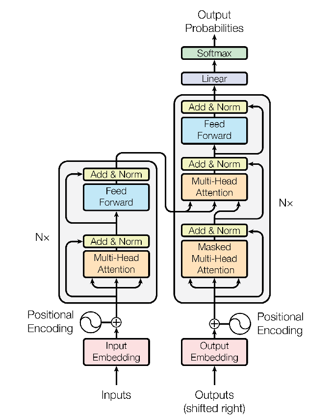
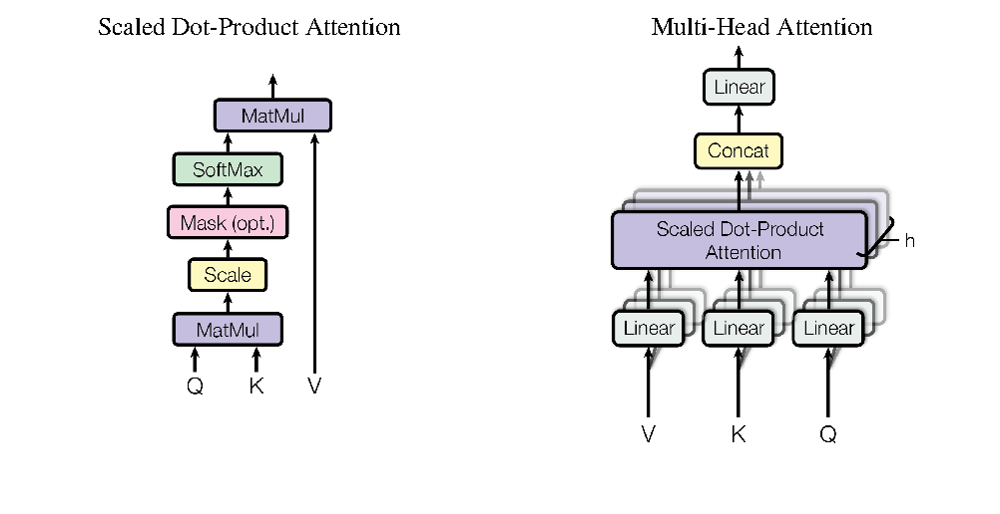
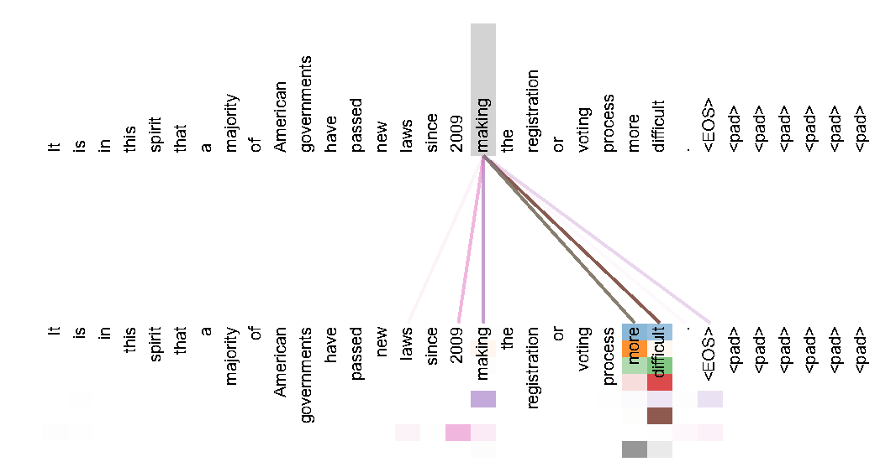
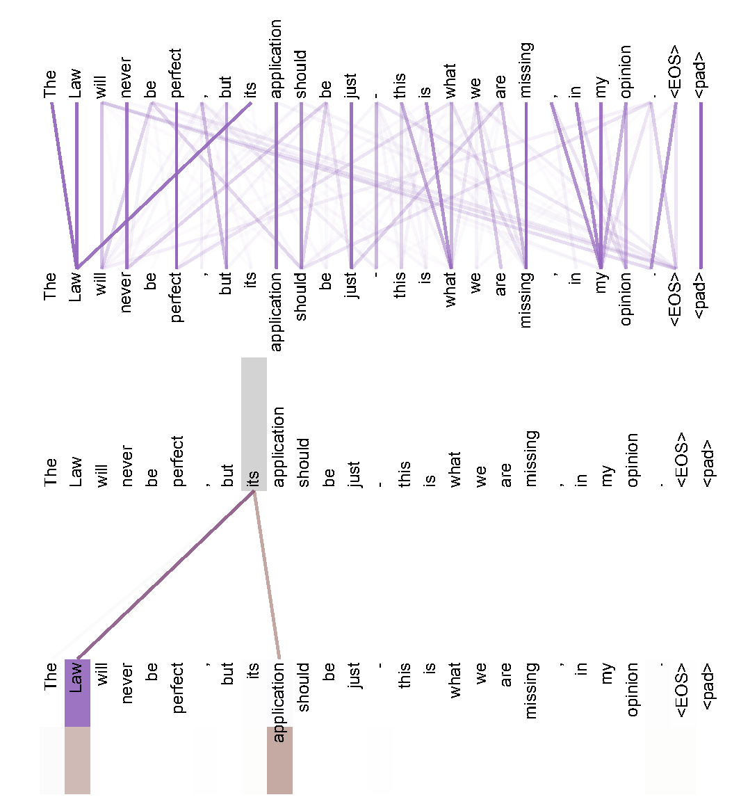
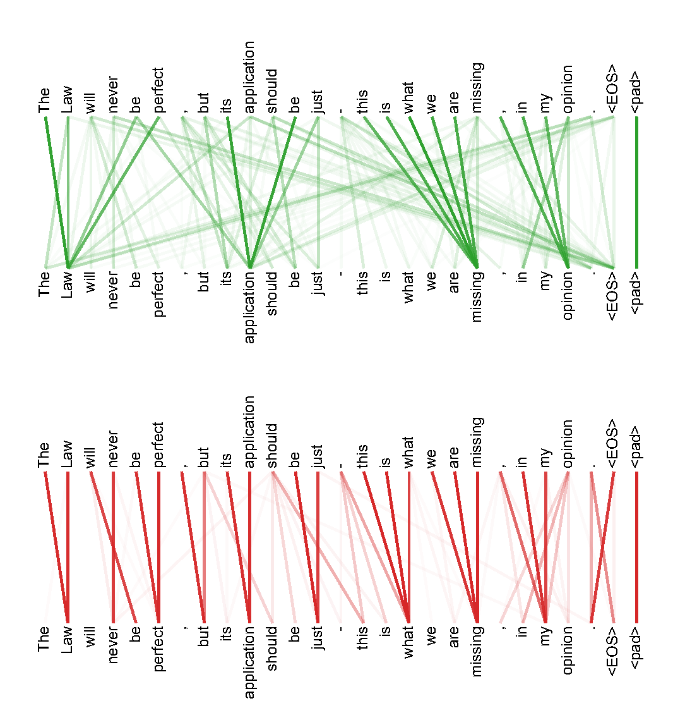

读这篇论文时，先分清训练中各位置的并行计算和推理时逐个 token 的生成。原版 Transformer 保留 Encoder 与 Decoder 结构，后面的讲解会把它与 decoder-only、RoPE、GQA 等现代实现逐处对照。

译自 Vaswani 等人的 [Attention Is All You Need，arXiv v7](https://arxiv.org/abs/1706.03762v7)，原作发表于 NIPS 2017。正文中的“我们”指论文作者，带有“讲解”标记的模块为阅读补充。

> [!NOTE] 术语速查
>
> **token / embedding** 是分词后的单位及其连续向量表示。**Encoder / Decoder** 分别编码输入与生成输出。
>
> **Query / Key / Value** 中，Q 发起匹配，K 用于计算匹配程度，V 提供被加权汇总的内容。**Self-Attention** 的 Q、K、V 来自同一个序列，**Cross-Attention** 的 Q 与 K/V 来自不同序列。
>
> **causal mask** 阻止当前位置读取后续位置。**FFN** 是逐位置的前馈网络，**LayerNorm** 是对特征维度进行的层归一化。
>
> **BLEU** 评价翻译，本文中越高越好；**PPL** 为困惑度，越低越好，其单位取决于分词方式。

## 摘要

主流序列转换模型以复杂的循环神经网络或卷积神经网络为基础，其中包含一个 Encoder 和一个 Decoder。表现最好的模型还通过 Attention 机制连接 Encoder 与 Decoder。我们提出一种简洁的新型网络架构 Transformer，它完全基于 Attention 机制，彻底去掉了循环结构和卷积。

两项机器翻译任务的实验表明，这些模型的质量更高，同时更易于并行计算，训练所需时间也显著缩短。在 WMT 2014 英语到德语翻译任务上，我们的模型取得了 28.4 BLEU，比包括集成模型在内的现有最佳结果高出 2 BLEU 以上。在 WMT 2014 英语到法语翻译任务上，我们的模型在 8 块 GPU 上训练 3.5 天后，取得了单模型的最新最佳成绩 41.8 BLEU，训练成本仅为文献中最佳模型的一小部分。

我们还在训练数据充足和有限两种情况下，成功将 Transformer 应用于英语 constituency parsing，表明它能够很好地泛化到其他任务。

> [!EXPLAIN] 读到这里先抓住什么
>
> 本文的任务是把一个序列转换成另一个序列，典型例子是把英语句子翻译成德语句子。文章要解决的核心问题，是摆脱 RNN 按位置逐步计算的依赖，让序列中各个位置能在一层内直接交换信息。标题中的 attention 指承担位置间信息交互的 Attention 机制；图 1 仍然包含 FFN、residual connection、归一化和 embedding 层。

> [!EXPLAIN] 版本与数值
>
> 原作发表于 NIPS 2017。本文依据的是标注 2023 年 8 月 2 日的 arXiv v7。摘要和表 2 的英法成绩为 41.8，6.1 节正文为 41.0，本文分别保留。下文“最佳”“最新”均对应论文当时的比较范围。

## 1 引言

循环神经网络，尤其是长短期记忆网络 LSTM [[13](#ref-13)] 和门控循环神经网络 [[7](#ref-7)]，已经成为语言建模、机器翻译等序列建模与序列转换问题中的领先方法 [[35](#ref-35), [2](#ref-2), [5](#ref-5)]。此后，大量研究继续拓展循环语言模型和 Encoder 与 Decoder 架构的能力 [[38](#ref-38), [24](#ref-24), [15](#ref-15)]。

循环模型通常沿输入与输出序列中各个符号的位置来分解计算。它们将序列位置对应到计算的时间步，依据前一个隐藏状态 $h_{t-1}$ 和位置 t 的输入，生成隐藏状态 $h_t$，从而得到一串隐藏状态。这种固有的顺序依赖，使单个训练样本内部无法并行计算；当序列变长时，这一问题尤其突出，因为内存限制又约束了跨样本批处理的规模。

近期研究通过因子分解技巧 [[21](#ref-21)] 和条件计算 [[32](#ref-32)] 显著提高了计算效率，其中条件计算还改善了模型性能。然而，顺序计算这一根本限制仍然存在。

Attention 机制已经成为多种任务中优秀序列建模与序列转换模型的重要组成部分，使模型能够建立依赖关系，而不受这些依赖在输入或输出序列中相隔距离的限制 [[2](#ref-2), [19](#ref-19)]。不过，除了少数情况 [[27](#ref-27)]，这些 Attention 机制都与循环网络结合使用。

本文提出 Transformer，这种模型架构舍弃循环结构，完全依靠 Attention 机制建立输入与输出之间的全局依赖。Transformer 的并行程度显著提高，在 8 块 P100 GPU 上仅训练 12 小时，就能取得翻译质量上的最新最佳结果。

> [!EXPLAIN] 训练并行和生成串行要分开理解
>
> RNN 的第 t 个隐藏状态依赖第 t−1 个隐藏状态，所以即使训练数据全部已知，也要沿位置推进。Transformer 训练时可以一次输入右移后的整句真实译文，并用因果掩码同时计算各位置的预测损失。推理时，下一个 token 尚未产生，普通自回归生成仍要逐个生成。本文去掉的顺序依赖发生在层内的序列表示计算中；生成过程的依赖仍然保留。

## 2 背景

减少顺序计算也是 Extended Neural GPU [[16](#ref-16)]、ByteNet [[18](#ref-18)] 和 ConvS2S [[9](#ref-9)] 的基本目标；这些模型都以卷积神经网络为基本构件，并行计算所有输入与输出位置的隐藏表示。在这些模型中，要让任意两个输入或输出位置的信号建立联系，所需操作次数会随位置距离增长；ConvS2S 中呈线性增长，ByteNet 中呈对数增长。这使远距离位置之间的依赖更难学习 [[12](#ref-12)]。

在 Transformer 中，这一操作次数降为常数，但代价是对不同位置进行 Attention 加权平均会降低有效分辨率；我们通过第 3.2 节介绍的 Multi-Head Attention 来缓解这一影响。

Self-Attention 有时也称为序列内 Attention，它通过关联同一个序列中的不同位置来计算该序列的表示。Self-Attention 已经成功用于阅读理解、生成式摘要、文本蕴含，以及学习与具体任务无关的句子表示等多种任务 [[4](#ref-4), [27](#ref-27), [28](#ref-28), [22](#ref-22)]。

端到端记忆网络采用循环的 Attention 机制，而不采用与序列位置逐一对应的循环结构；已有研究表明，它在简单语言问答和语言建模任务上表现良好 [[34](#ref-34)]。

不过，据我们所知，Transformer 是第一个完全依靠 Self-Attention 来计算输入与输出表示、且不使用与序列位置对齐的 RNN 或卷积的序列转换模型。接下来的章节将介绍 Transformer，解释采用 Self-Attention 的动机，并讨论它相对于文献 [[17](#ref-17), [18](#ref-18)] 和 [[9](#ref-9)] 等模型的优势。

> [!EXPLAIN] 为什么需要多个头
>
> 一次加权求和会把不同来源的信息混合成一个向量。多个头各自计算一份 Attention 分布，在不同投影空间中保留不同的组合，最后再合并。各个头的作用由训练形成，原文没有预先指定某个头专门处理语法、某个头专门处理语义。

## 3 模型架构

大多数有竞争力的神经序列转换模型都采用 Encoder 与 Decoder 结构 [[5](#ref-5), [2](#ref-2), [35](#ref-35)]。在这种结构中，Encoder 将符号表示的输入序列 $(x_1,\ldots,x_n)$ 映射为连续表示序列 z = $(z_1,\ldots,z_n)$。给定 z 后，Decoder 逐个生成符号，得到输出序列 $(y_1,\ldots,y_m)$。

模型的每一步都采用自回归方式 [[10](#ref-10)]，在生成下一个符号时，把此前已经生成的符号作为额外输入。

*图 1　Transformer 的模型架构。 图片出自 Vaswani 等，原文第 3 页。*

Transformer 遵循这一总体架构，Encoder 和 Decoder 都采用堆叠的 Self-Attention 层与逐位置全连接层，分别如图 1 的左半部分和右半部分所示。

> [!EXPLAIN] 沿图 1 走一遍
>
> 左侧把整句源语言 token 变成一串上下文化向量。右侧先读取已知的目标语言前缀，再通过中间的 Cross-Attention 读取左侧输出，最后给出下一个目标 token 的概率分布。图中的 N× 表示重复堆叠 N 层，Add & Norm 表示残差相加后归一化。

> [!EXPLAIN] 与现代文本大模型对照
>
> 以 Llama 系列的纯文本语言模型为例，可以把输入提示和回答接成一条序列，用因果 Self-Attention 预测下一个 token。这样的 decoder-only 结构没有图 1 左侧的独立 Encoder，也没有这张图中连接左右两侧的 Cross-Attention 子层。多模态模型仍可能使用独立 Encoder 和 Cross-Attention，具体结构应按模型区分。结构见 [M10](#M10)，多模态扩展的例子见 [M1](#M1)。

### 3.1 Encoder 与 Decoder 堆叠

Encoder 由 N = 6 个结构相同的层堆叠而成。每层包含两个子层。第一个子层是 Multi-Head Self-Attention 机制，第二个是简单的逐位置全连接 FFN。

我们在这两个子层外分别加入 residual connection [[11](#ref-11)]，随后进行 LayerNorm [[1](#ref-1)]。也就是说，每个子层的输出为 LayerNorm(x + Sublayer(x))，其中 Sublayer(x) 是该子层自身实现的函数。为了便于进行这些 residual connection，模型的所有子层以及 embedding 层的输出维度均设为 $d_{\mathrm{model}}$ = 512。

Decoder 同样由 N = 6 个结构相同的层堆叠而成。除了 Encoder 每层中的那两个子层，Decoder 还加入第三个子层，对 Encoder 堆叠的输出执行 Multi-Head Attention。与 Encoder 类似，我们在每个子层外加入 residual connection，随后进行 LayerNorm。

我们还修改了 Decoder 堆叠中的 Self-Attention 子层，阻止各位置关注其后续位置。这种掩码与输出 embedding 右移一个位置的做法结合，确保对位置 i 的预测只能依赖位置小于 i 的已知输出。

> [!EXPLAIN] 同构层不等于共享权重
>
> identical layers 指各层具有相同的结构，各层仍有各自的可学习参数。$d_{\mathrm{model}}$ 相同保证残差相加的两项形状一致。后文 3.3 还会明确说明，FFN 跨层使用不同参数。

> [!EXPLAIN] Post-LN 与 Pre-LN
>
> 原文采用 Post-LN，写成 y = LayerNorm(x + F(x))。另一种常见安排是 Pre-LN，写成 y = x + F(Norm(x))。归一化的位置改变了残差路径和初始化时的梯度行为，相关分析见 [M2](#M2)。RMSNorm 则改变归一化运算本身，用均方根缩放而不减均值，见 [M3](#M3)。位置安排与归一化类型是两个独立选择。

> [!EXPLAIN] 右移和掩码各负责什么
>
> 教学示例中，若目标是“我 爱 你 EOS”，Decoder 输入就是“BOS 我 爱 你”，监督目标仍是“我 爱 你 EOS”。第 3 个输入位置拿到“爱”，预测“你”，它可以看自己和更早的输入位置，但不能看右边已经放入的“你”。右移避免当前位置直接拿到自己的答案，掩码避免从后续位置偷看答案。

### 3.2 Attention

Attention 函数可以描述为把一个查询向量和一组键值对映射成一个输出，其中查询、键、值和输出都是向量。输出通过对各个值进行加权求和得到，而每个值的权重由查询与相应键之间的匹配函数计算。

*图 2 左　Scaled Dot-Product Attention。图 2 右　Multi-Head Attention 由若干并行运行的 Attention 层组成。 图片出自 Vaswani 等，原文第 4 页。*

#### 3.2.1 Scaled Dot-Product Attention

我们将这里采用的 Attention 称为“Scaled Dot-Product Attention”，如图 2 所示。输入包括维度为 $d_k$ 的查询和键，以及维度为 $d_v$ 的值。我们计算查询与所有键的点积，将每个点积除以 $\sqrt{d_k}$，再应用 softmax 函数，得到各个值的权重。

实际计算时，我们把一组查询组合成矩阵 Q，同时计算它们的 Attention 函数。键和值也分别组合为矩阵 K 和 V。输出矩阵按下式计算。

$$
\operatorname{Attention}(Q,K,V)=\operatorname{softmax}\!\left(\frac{QK^{\mathsf T}}{\sqrt{d_k}}\right)V\tag{1}
$$

> [!EXPLAIN] 把公式 1 的形状写出来
>
> 对一个头，令查询数量为 n_q，键和值的数量为 n_k。Q 的形状是 n_q × $d_k$，K 是 n_k × $d_k$，V 是 n_k × $d_v$。QKᵀ 得到 n_q × n_k 的分数矩阵，softmax 沿每行的键位置归一化，再乘 V，输出 n_q × $d_v$。Self-Attention 中两种长度通常相等；Cross-Attention 中源句和目标句可以长短不同。

> [!EXPLAIN] 一个可手算的 Attention 例子
>
> 假设某个查询与两个键的缩放后分数都是 0，softmax 权重就是 [0.5, 0.5]。若两个值是 [2, 0] 和 [0, 4]，输出就是 [1, 2]。把第二个键位置的分数设为 −∞ 后，权重变为 [1, 0]，输出变为 [2, 0]。匹配分数由 Q 与 K 决定，实际汇总的内容来自 V。

最常用的两种 Attention 函数是加性 Attention [[2](#ref-2)] 和点积 Attention，也称乘性 Attention。点积 Attention 与我们的算法相同，只是缺少 $\frac{1}{\sqrt{d_k}}$ 这一缩放因子。加性 Attention 使用一个具有单个隐藏层的 FFN 来计算匹配函数。

两者的理论复杂度相近，但点积 Attention 在实际中快得多，也更节省存储空间，因为它可以用经过高度优化的矩阵乘法代码实现。

当 $d_k$ 较小时，两种机制表现相近；当 $d_k$ 较大时，加性 Attention 优于未缩放的点积 Attention [[3](#ref-3)]。我们推测，当 $d_k$ 较大时，点积的数值幅度会变大，使 softmax 函数进入梯度极小的区域。[^dot-product]为了抵消这一影响，我们将点积乘以 $\frac{1}{\sqrt{d_k}}$。

> [!EXPLAIN] 为什么恰好除以平方根
>
> 脚注 4 的假设是各分量独立、均值为 0、方差为 1，此时 q·k 的方差为 $d_k$，标准差为 $\sqrt{d_k}$。除以 $\sqrt{d_k}$ 后，方差回到 1。对 $d_k$ = 64 的头，除数是 8。这里控制的是分数的尺度，避免 softmax 过早集中到极少数位置；它不保证训练后所有分数都服从这一假设。

> [!EXPLAIN] 现代实现仍保留这条计算主线
>
> FlashAttention 通过分块与重计算减少 GPU 不同层级存储之间的读写，避免把完整 Attention 矩阵写入显存。它计算精确的 Attention，允许浮点舍入差异；对稠密 Attention，主要算术计算量仍随序列长度平方增长。来源见 [M4](#M4)。

#### 3.2.2 Multi-Head Attention

我们发现，与直接使用 $d_{\mathrm{model}}$ 维的键、值和查询执行一次 Attention 相比，通过 h 组不同的可学习线性投影，将查询、键和值分别投影到 $d_k$、$d_k$ 和 $d_v$ 维会更有效。随后，我们在每组投影后的查询、键和值上并行执行 Attention 函数，得到 $d_v$ 维的输出值。我们将这些输出拼接起来，再进行一次投影，得到最终结果，如图 2 所示。

Multi-Head Attention 使模型能够同时关注不同位置、不同表示子空间中的信息。在单头 Attention 中，加权平均会限制这种能力。

$$
\operatorname{MultiHead}(Q,K,V)=\operatorname{Concat}(\mathrm{head}_1,\ldots,\mathrm{head}_h)W^O
$$

$$
\mathrm{head}_i=\operatorname{Attention}(QW_i^Q,KW_i^K,VW_i^V)
$$

其中，各投影的参数矩阵分别为 $W_i^Q\in\mathbb{R}^{d_{\mathrm{model}}\times d_k}$、$W_i^K\in\mathbb{R}^{d_{\mathrm{model}}\times d_k}$、$W_i^V\in\mathbb{R}^{d_{\mathrm{model}}\times d_v}$，以及 $W^O\in\mathbb{R}^{hd_v\times d_{\mathrm{model}}}$。

本文采用 h = 8 个并行 Attention 层，也就是 8 个头。每个头使用 $d_k$ = $d_v$ = $d_{\mathrm{model}}$/h = 64。由于每个头的维度有所降低，总计算成本与使用完整维度的单头 Attention 相近。

> [!EXPLAIN] 8 个头不会把输出宽度变成 8×512
>
> 每个头输出 64 维，8 个头拼接后为 512 维，再经 Wᴼ 混合。按原文的配置，Q、K、V 各头投影矩阵合计各有 512² 个参数，输出投影也有 512² 个参数，忽略偏置时共 1,048,576 个。多头的主要矩阵乘法工作量与同宽单头接近，更多头还会带来 softmax 和显式 Attention 矩阵存储的额外开销。

> [!EXPLAIN] GQA 改变了哪一部分
>
> 原文每个查询头都有各自的 K/V 头。GQA 让一组查询头共享一个 K/V 头，用较少的 K/V 头减少解码时的缓存和访存开销。例子是 Llama 3 8B 使用 32 个查询头和 8 个 K/V 头，每 4 个查询头共享一组 K/V。来源见 [M5](#M5) 和 [M1](#M1)。

#### 3.2.3 本模型中 Attention 的用法

Transformer 以三种方式使用 Multi-Head Attention。

在“Encoder-Decoder Attention”层中，查询来自前一个 Decoder 层，作为记忆的键和值来自 Encoder 输出。这使 Decoder 中的每个位置都能关注输入序列中的所有位置。这种做法沿用了文献 [[38](#ref-38), [2](#ref-2), [9](#ref-9)] 等序列到序列模型中典型的 Encoder-Decoder Attention 机制。

Encoder 包含 Self-Attention 层。在 Self-Attention 层中，所有键、值和查询都来自同一处，在这里就是 Encoder 前一层的输出。Encoder 中的每个位置都可以关注 Encoder 前一层中的所有位置。

类似地，Decoder 中的 Self-Attention 层允许每个位置关注 Decoder 中截至该位置的所有位置，包括该位置本身。为了保持自回归特性，我们需要阻止 Decoder 中的信息从右向左流动。我们在 Scaled Dot-Product Attention 内部实现这一限制，把 softmax 输入中所有对应非法连接的数值掩蔽掉，即设为 −∞。

参见图 2。

> [!EXPLAIN] “来源相同”不表示 Q、K、V 数值相同
>
> Self-Attention 中，同一份隐藏表示 X 经过三套不同的投影，得到 Q = XW^Q、K = XW^K、V = XW^V。Cross-Attention 则让 Q 取自目标序列，K 和 V 取自源序列。掩码要加在 softmax 之前的分数上，softmax 后被掩蔽位置的权重才为 0。

### 3.3 逐位置 FFN

除了 Attention 子层，我们的 Encoder 和 Decoder 每层还包含一个全连接 FFN，以相同的方式分别作用于每个位置。该网络由两次线性变换组成，中间使用 ReLU 激活函数。

$$
\operatorname{FFN}(x)=\max(0,xW_1+b_1)W_2+b_2\tag{2}
$$

这些线性变换在不同位置之间相同，但不同层使用不同参数。也可以把它描述为两次卷积核大小为 1 的卷积。输入与输出的维度为 $d_{\mathrm{model}}$ = 512，中间层的维度为 $d_{\mathrm{ff}}$ = 2048。

> [!EXPLAIN] Attention 和 FFN 分别做什么
>
> Attention 负责不同位置之间的信息混合，FFN 在每个位置内部做非线性变换，不直接读取其他位置。这里的维度变化为 512 → 2048 → 512。同一层的所有位置共享 FFN 参数，所以整段序列可以一起计算。

> [!EXPLAIN] 现代 FFN 的一条变化
>
> GLU 变体引入两路投影的逐元素乘积。以忽略偏置的 SwiGLU 为例，可以写成 [SiLU(xW_gate) ⊙ (xW_up)] W_down。Llama 3 使用 SwiGLU，见 [M6](#M6) 与 [M1](#M1)。它改变了位置内的计算，位置之间的信息交换仍由 Attention 负责。

### 3.4 embedding 与 Softmax

与其他序列转换模型类似，我们使用可学习的 embedding，将输入 token 和输出 token 转换为 $d_{\mathrm{model}}$ 维向量。我们还使用常见的可学习线性变换和 softmax 函数，将 Decoder 输出转换为下一个 token 的预测概率。在我们的模型中，两个 embedding 层与 softmax 之前的线性变换共享同一权重矩阵，与文献 [[30](#ref-30)] 的做法类似。

在 embedding 层中，我们将这些权重乘以 $\sqrt{d_{\mathrm{model}}}$。

> [!EXPLAIN] token 与输出词表
>
> token 是分词器处理后的单位，可能是整词、子词或其他片段，不宜固定译为“单词”。若词表大小为 V，embedding 矩阵 E 的形状为 V × $d_{\mathrm{model}}$。输入用 token 编号取出一行；输出端可用隐藏向量乘 Eᵀ，得到 V 个 logits，再经 softmax 得到概率。输入端的 $\sqrt{d_{\mathrm{model}}}$ 缩放适用于 embedding 计算，不应顺手加到共享的输出映射上。

### 3.5 Positional Encoding

由于模型既没有循环结构，也没有卷积，为了使模型利用序列的顺序，我们必须注入一些关于 token 在序列中相对位置或绝对位置的信息。为此，我们在 Encoder 和 Decoder 堆叠的底部，将“Positional Encoding”加到输入 embedding 中。Positional Encoding 与 embedding 具有相同的维度 $d_{\mathrm{model}}$，因此两者可以相加。

Positional Encoding 有许多选择，既有可学习的，也有固定的 [[9](#ref-9)]。本文使用不同频率的正弦和余弦函数。

$$
PE_{(pos,2i)}=\sin\!\left(\frac{pos}{10000^{2i/d_{\mathrm{model}}}}\right)
$$

$$
PE_{(pos,2i+1)}=\cos\!\left(\frac{pos}{10000^{2i/d_{\mathrm{model}}}}\right)
$$

其中，pos 表示位置，i 表示维度索引。也就是说，Positional Encoding 的每个维度都对应一条正弦曲线。各波长构成从 2π 到 10000·2π 的等比数列。

我们选择这个函数，是因为我们猜想它能让模型容易地学会按相对位置进行关注，因为对于任何固定偏移量 k，PE_(pos+k) 都可以表示成 PE_pos 的线性函数。

我们也尝试改用可学习的 positional embedding [[9](#ref-9)]，发现两种版本的结果几乎相同，见表 3 的 (E) 行。我们选择正弦形式，是因为它可能允许模型外推到比训练中见过的序列更长的长度。

> [!EXPLAIN] 为什么平移后仍是线性函数
>
> 对某一频率，设 θ = pos/10000^(2i/$d_{\mathrm{model}}$)，δ = k/10000^(2i/$d_{\mathrm{model}}$)。由 sin(θ+δ) = sinθ cosδ + cosθ sinδ 和 cos(θ+δ) = cosθ cosδ − sinθ sinδ，平移 k 只需对一对正余弦分量做固定的二维线性变换。
>
> 公式中的 2i 和 2i+1 对应成对的通道。按有限维公式，最高波长严格为 2π·10000^(($d_{\mathrm{model}}$−2)/$d_{\mathrm{model}}$)，原文的 10000·2π 给出的是端点尺度。

> [!EXPLAIN] 和 RoPE 的联系
>
> 原文把位置向量加到输入 embedding。RoPE 则按位置旋转 Q 与 K 的二维分量，使它们的点积显式包含相对位置关系。两者都利用正余弦结构，作用位置和计算方式不同。固定公式能在更长位置上求值，并不保证模型在训练范围外保持效果，实际长上下文模型还需要相应训练和位置策略。来源见 [M7](#M7)；Llama 3 的应用见 [M1](#M1)。

## 4 为什么使用 Self-Attention

本节从多个方面比较 Self-Attention 层与常见的循环层和卷积层；这些层把一个可变长度的符号表示序列 $(x_1,\ldots,x_n)$ 映射到另一个等长序列 $(z_1,\ldots,z_n)$，其中 x_i、z_i ∈ $\mathbb{R}^d$，典型序列转换 Encoder 或 Decoder 中的隐藏层就是这样的例子。为了说明采用 Self-Attention 的动机，我们考虑三个目标。

第一个是每层的总计算复杂度。第二个是计算能够并行化的程度，用所需的最少顺序操作次数来衡量。

第三个是网络中远距离依赖之间的路径长度。学习远距离依赖是许多序列转换任务中的关键挑战。影响这种依赖学习能力的关键因素之一，是前向和反向信号必须在网络中经过的路径长度。

输入与输出序列中任意位置组合之间的这些路径越短，远距离依赖就越容易学习 [[12](#ref-12)]。因此，我们还比较由不同类型层构成的网络中，任意两个输入与输出位置之间的最大路径长度。

**表 1　不同层类型的最大路径长度、每层复杂度，以及最少顺序操作次数。**

n 表示序列长度，d 表示表示向量的维度，k 表示卷积核大小，r 表示受限 Self-Attention 中的邻域大小。

| 层类型 | 每层复杂度 | 顺序操作次数 | 最大路径长度 |
| --- | --- | --- | --- |
| Self-Attention | O(n²·d) | O(1) | O(1) |
| Recurrent | O(n·d²) | O(n) | O(n) |
| Convolutional | O(k·n·d²) | O(1) | O(log_k n) |
| 受限 Self-Attention | O(r·n·d) | O(1) | O(n/r) |

如表 1 所示，Self-Attention 层通过常数次顺序执行的操作连接所有位置，而循环层需要 O(n) 次顺序操作。从计算复杂度看，当序列长度 n 小于表示维度 d 时，Self-Attention 层比循环层更快，而当时领先机器翻译模型所采用的句子表示，如 word-piece [[38](#ref-38)] 和 BPE 表示 [[31](#ref-31)]，通常符合这一情况。为了提高超长序列任务中的计算性能，可以把 Self-Attention 限制在输入序列中以相应输出位置为中心、大小为 r 的邻域内。

这会使最大路径长度增加到 O(n/r)。我们计划在未来工作中进一步研究这一方法。

当卷积核宽度 k < n 时，单个卷积层无法连接所有输入与输出位置对。要实现这种连接，连续卷积核需要堆叠 O(n/k) 个卷积层，空洞卷积 [[18](#ref-18)] 则需要 O(log_k(n)) 个卷积层；这会增加网络中任意两个位置之间最长路径的长度。卷积层的计算成本通常是循环层的 k 倍。

不过，可分离卷积 [[6](#ref-6)] 能将复杂度显著降低到 O(k·n·d + n·d²)。即使取 k = n，可分离卷积的复杂度也与一个 Self-Attention 层加一个逐位置前馈层的组合相同，而我们的模型采用的正是这种组合。

作为额外好处，Self-Attention 可能产生更易解释的模型。我们检查了模型中的 Attention 分布，并在附录中展示和讨论了一些例子。各个 Attention Head 明显学会了执行不同任务，而且许多头表现出的行为似乎与句子的句法和语义结构有关。

> [!EXPLAIN] 表 1 的 O(1) 指什么
>
> 它表示位置之间建立连接所需的顺序计算步数不随序列长度增长，总计算量仍有 O(n²d)。表中的 Self-Attention 复杂度主要描述位置交互部分；完整模块还包含 Q/K/V 和输出投影的 O(nd²)，FFN 还需要 O(nd·$d_{\mathrm{ff}}$)。卷积的 O(log_k n) 路径对应能指数扩大感受野的空洞卷积安排；普通连续卷积核的路径见正文 O(n/k)。

> [!EXPLAIN] 用长序列重新理解成本
>
> 教学计算中，n = 32768 时，一个头的 n×n 分数矩阵就有 1,073,741,824 个元素，若按每元素 2 字节显式存储，单矩阵为 2 GiB，尚未计入其他头、批次、梯度和中间量。FlashAttention 减少这类中间矩阵的显存开销，稠密的两两交互计算仍然存在。局部 Attention 则直接减少连接，代价是远距离信息需要更多层才能传过去。

> [!EXPLAIN] Attention 可视化怎样读
>
> 颜色和连线能帮助发现 Attention 模式，单个较大的权重还不足以确定某个输入对最终预测的因果贡献。后续实验展示了不同 Attention 分布可能产生近似相同输出，见 [M8](#M8)。读附录时，把“观察到某种关联”与“已经证明该头承担某种功能”分开。

## 5 训练

本节介绍我们模型的训练方案。

### 5.1 训练数据与批处理

我们在标准的 WMT 2014 英德数据集上训练，其中包含约 450 万个句对。句子使用 BPE [[3](#ref-3)] 进行编码，源语言与目标语言共享一个约含 37000 个 token 的词表。对于英法翻译，我们使用规模大得多的 WMT 2014 英法数据集，其中包含 3600 万个句子，并将 token 切分为一个含 32000 个 word-piece 的词表 [[38](#ref-38)]。

我们按大致相近的序列长度将句对组成批次。每个训练批次包含一组句对，合计约有 25000 个源语言 token 和 25000 个目标语言 token。

> [!EXPLAIN] 数据单位与引文
>
> 英德这一句明确写的是 sentence pairs，英法这一句原文写的是 sentences，译文分别保留“句对”和“句子”。此处 BPE 后的原文引文编号为 [3]，文末 [3] 是架构探索论文，[31] 才是子词单元翻译论文；本文保留原编号。按长度组批可减少 padding 的无效计算，批大小按 token 数控制，句子数量可随长度变化。

### 5.2 硬件与训练安排

我们在一台配备 8 块 NVIDIA P100 GPU 的机器上训练模型。对于采用本文所述超参数的基础模型，每个训练步约需 0.4 秒。基础模型共训练 100000 步，耗时约 12 小时。

对于表 3 最后一行所述的大模型，每步耗时 1.0 秒。大模型训练了 300000 步，耗时 3.5 天。

> [!EXPLAIN] 这些时间是论文的近似报告
>
> 按 0.4 秒乘 100000 步，得到约 11.1 小时；按 1 秒乘 300000 步，得到约 3.47 天。这里的步时和总时长都是报告尺度的近似值，不能据此推导精确的硬件利用率。

### 5.3 优化器

我们使用 Adam 优化器 [[20](#ref-20)]，参数为 β₁ = 0.9、β₂ = 0.98，以及 ϵ = 10⁻⁹。训练过程中，我们按照下面的公式调整学习率。

$$
\mathrm{lrate}=d_{\mathrm{model}}^{-0.5}\min\!\left(\mathrm{step\_num}^{-0.5},\mathrm{step\_num}\cdot\mathrm{warmup\_steps}^{-1.5}\right)\tag{3}
$$

这相当于在最初 warmup_steps 个训练步中线性提高学习率，此后使学习率按步数的平方根倒数成比例下降。我们取 warmup_steps = 4000。

> [!EXPLAIN] 学习率曲线的交点
>
> 在第 4000 步，两项相等。基础模型的峰值学习率为 1/√(512×4000)，约 6.99×10⁻⁴；第 16000 步约为峰值的一半。warmup 让训练开始时的更新逐渐增大，后半程则降低更新尺度。它是本文的训练配方，后续模型可以采用其他调度，不能把这条曲线当作 Transformer 的结构定义。

### 5.4 正则化

我们在训练中采用三种正则化方式。

#### 残差分支的 Dropout

我们对每个子层的输出应用 dropout [[33](#ref-33)]，然后再将其与该子层的输入相加并进行归一化。此外，在 Encoder 和 Decoder 堆叠中，我们也对 embedding 与 Positional Encoding 之和应用 dropout。对基础模型，我们使用 P_drop = 0.1。

#### Label Smoothing

训练中，我们采用强度为 ϵ_ls = 0.1 的 Label Smoothing [[36](#ref-36)]。这会损害 PPL 表现，因为模型学会了降低确信程度，但能提高准确率和 BLEU 分数。

> [!EXPLAIN] Label Smoothing 为什么能改善 BLEU 却损害 PPL
>
> Label Smoothing 把一部分目标概率质量分配给其他类别，抑制模型对训练标签过度确信。常见约定之一是给正确类别 1−ϵ，其余类别共享 ϵ；具体分配依实现约定而定。
>
> PPL 根据真实目标 token 的概率计算，越低越好，BLEU 则评价生成译文与参考译文的匹配情况，两者可以朝不同方向变化。原文声称“三种”，本小节只有 Residual Dropout 和 Label Smoothing 两个小标题；6.3 节另提到 attention dropout，这里不替原文补写第三个条目。

## 6 结果

### 6.1 机器翻译

**表 2　在英德和英法的 newstest2014 测试集上，Transformer 取得了优于此前领先模型的 BLEU 分数，而训练成本仅为它们的一小部分。**

空缺表示原表未报告。Transformer 两行的训练成本在原表中以跨英德、英法两列的单个数值列出，本表保留这一口径。Ensemble 表示模型集成。

| 模型 | BLEU 英德 | BLEU 英法 | 训练 FLOPs 英德 | 训练 FLOPs 英法 |
| --- | --- | --- | --- | --- |
| ByteNet [[18](#ref-18)] | 23.75 | 空缺 | 空缺 | 空缺 |
| Deep-Att + PosUnk [[39](#ref-39)] | 空缺 | 39.2 | 空缺 | 1.0×10²⁰ |
| GNMT + RL [[38](#ref-38)] | 24.6 | 39.92 | 2.3×10¹⁹ | 1.4×10²⁰ |
| ConvS2S [[9](#ref-9)] | 25.16 | 40.46 | 9.6×10¹⁸ | 1.5×10²⁰ |
| MoE [[32](#ref-32)] | 26.03 | 40.56 | 2.0×10¹⁹ | 1.2×10²⁰ |
| Deep-Att + PosUnk Ensemble [[39](#ref-39)] | 空缺 | 40.4 | 空缺 | 8.0×10²⁰ |
| GNMT + RL Ensemble [[38](#ref-38)] | 26.30 | 41.16 | 1.8×10²⁰ | 1.1×10²¹ |
| ConvS2S Ensemble [[9](#ref-9)] | 26.36 | 41.29 | 7.7×10¹⁹ | 1.2×10²¹ |
| Transformer 基础模型 | 27.3 | 38.1 | 3.3×10¹⁸（原表跨两列） |  |
| Transformer 大模型 | 28.4 | 41.8 | 2.3×10¹⁹（原表跨两列） |  |

在 WMT 2014 英德翻译任务上，Transformer 大模型，即表 2 中的 Transformer (big)，比此前报告的最佳模型，包括集成模型，高出 2.0 BLEU 以上，取得了新的最佳成绩 28.4 BLEU。该模型的配置列在表 3 的最后一行。在 8 块 P100 GPU 上训练耗时 3.5 天。

即使是我们的基础模型，也超过了此前所有已发表的模型和集成模型，训练成本仅为各个有竞争力模型的一小部分。在 WMT 2014 英法翻译任务上，我们的大模型取得了 41.0 BLEU，优于此前所有已发表的单模型，训练成本还不到此前最佳模型的四分之一。用于英法翻译的 Transformer 大模型采用 P_drop = 0.1 的 dropout 比率，而非 0.3。

> [!EXPLAIN] 41.0 与 41.8 的原文冲突
>
> 上一句忠实保留本节的 41.0。摘要和表 2 的同一任务写为 41.8，这份 PDF 没有在此解释差异。表 2 中的单模型 ConvS2S 为 40.46，集成模型为 41.29；引用具体结果时应同时注明采用的原文位置。

对基础模型，我们将最后 5 个 checkpoint 的参数取平均，得到一个单模型；这些 checkpoint 每隔 10 分钟保存一次。对大模型，我们对最后 20 个 checkpoint 取平均。我们使用 Beam Search，beam size 为 4，长度惩罚参数 α = 0.6 [[38](#ref-38)]。

这些超参数是在开发集上实验后选定的。推理时，我们将最大输出长度设为输入长度加 50，但会在可以提前结束时终止生成 [[38](#ref-38)]。

**表 2 总结了我们的结果，并将翻译质量和训练成本与文献中的其他模型架构进行比较。**

我们将训练时间、使用的 GPU 数量，以及每块 GPU 持续单精度浮点运算能力的估计值相乘，以估算模型训练所用的浮点运算次数。[^training-flops]

> [!EXPLAIN] 参数平均与模型集成的区别
>
> checkpoint 平均把多份权重合成一份，推理时仍运行一个模型。模型集成通常需要运行多个模型并合并预测。Beam Search 在每一步保留若干候选序列，beam size 4 表示保留 4 个候选，和 Attention Head 数无关。这里的训练 FLOPs 是根据设备能力和用时估算的口径，不能当作逐算子测得的精确计算量。

### 6.2 模型变体

为了评估 Transformer 不同组成部分的重要性，我们以多种方式改变基础模型，并在英德翻译开发集 newstest2013 上测量性能变化。我们使用前一节所述的 Beam Search，但没有进行 checkpoint 平均。这些结果见表 3。

**表 3　Transformer 架构的变体。**

未列出的数值与基础模型相同。所有指标均在英德翻译开发集 newstest2013 上测得。所列 PPL 以我们的 BPE word-piece 为单位，不应与按完整单词计算的 PPL 比较。

为便于阅读，将原表的稀疏超参数列改排为“改动”一列，未改动的配置均沿用 base。训练步数和参数量的空白按原表“与基础模型相同”的说明补全。K 表示千，参数量以百万计。

| 组别 | 配置或相对基础模型的改动 | 训练步数 | PPL 开发集 | BLEU 开发集 | 参数量／百万 |
| --- | --- | --- | --- | --- | --- |
| base | N=6；d_model=512；d_ff=2048；h=8；d_k=d_v=64；P_drop=0.1；ϵ_ls=0.1 | 100K | 4.92 | 25.8 | 65 |
| A | h=1；d_k=d_v=512 | 100K | 5.29 | 24.9 | 65 |
| A | h=4；d_k=d_v=128 | 100K | 5.00 | 25.5 | 65 |
| A | h=16；d_k=d_v=32 | 100K | 4.91 | 25.8 | 65 |
| A | h=32；d_k=d_v=16 | 100K | 5.01 | 25.4 | 65 |
| B | d_k=16 | 100K | 5.16 | 25.1 | 58 |
| B | d_k=32 | 100K | 5.01 | 25.4 | 60 |
| C | N=2 | 100K | 6.11 | 23.7 | 36 |
| C | N=4 | 100K | 5.19 | 25.3 | 50 |
| C | N=8 | 100K | 4.88 | 25.5 | 80 |
| C | d_model=256；d_k=d_v=32 | 100K | 5.75 | 24.5 | 28 |
| C | d_model=1024；d_k=d_v=128 | 100K | 4.66 | 26.0 | 168 |
| C | d_ff=1024 | 100K | 5.12 | 25.4 | 53 |
| C | d_ff=4096 | 100K | 4.75 | 26.2 | 90 |
| D | P_drop=0.0 | 100K | 5.77 | 24.6 | 65 |
| D | P_drop=0.2 | 100K | 4.95 | 25.5 | 65 |
| D | ϵ_ls=0.0 | 100K | 4.67 | 25.3 | 65 |
| D | ϵ_ls=0.2 | 100K | 5.47 | 25.7 | 65 |
| E | 可学习的 positional embedding 替代正弦函数 | 100K | 4.92 | 25.7 | 65 |
| big | N=6；d_model=1024；d_ff=4096；h=16；d_k=d_v=64；P_drop=0.3；ϵ_ls=0.1 | 300K | 4.33 | 26.4 | 213 |

在表 3 的 (A) 组中，我们按第 3.2.2 节所述，改变 Attention Head 数以及键和值的维度，同时保持计算量不变。单头 Attention 比最佳设置低 0.9 BLEU，但头数过多时，质量也会下降。

在表 3 的 (B) 组中，我们观察到，减小 Attention 键的维度 $d_k$ 会损害模型质量。这表明，判断匹配程度并不容易，比点积更复杂的匹配函数可能有益。在 (C) 和 (D) 组中，我们还观察到，符合预期的是，更大的模型表现更好，dropout 对避免过拟合很有帮助。

在 (E) 行中，我们用可学习的 positional embedding [[9](#ref-9)] 替换正弦 Positional Encoding，得到与基础模型几乎相同的结果。

> [!EXPLAIN] 从表 3 能得出多强的结论
>
> (A) 中单头为 24.9，8 头和 16 头均为 25.8，32 头为 25.4，所以增加头数并不保证提升。(B) 减小 $d_k$ 导致 BLEU 下降，这是实验观察；“更复杂的匹配函数可能有益”是作者据此提出的解释和后续方向。它没有在这张表里得到直接验证。

> [!EXPLAIN] 开发集与测试集不要混用
>
> 表 3 的基础模型 BLEU 为 25.8，大模型为 26.4，都是 newstest2013 开发集结果，而且未做 checkpoint 平均。表 2 的 27.3 和 28.4 是 newstest2014 测试结果。两张表的差值不能直接归因于某一个结构变化。另一个细节是 (C) 把层数从 6 增至 8 时，PPL 从 4.92 降到 4.88，但 BLEU 从 25.8 降到 25.5；原文“更大更好”是概括，表内并非每个增大配置都提高 BLEU。

### 6.3 英语 constituency parsing

为了评估 Transformer 能否泛化到其他任务，我们进行了英语 constituency parsing 实验。这一任务具有特定挑战，输出受到严格的结构约束，而且明显长于输入。此外，RNN 序列到序列模型在小数据条件下尚未取得领先结果 [[37](#ref-37)]。

我们在 Penn Treebank [[25](#ref-25)] 的《华尔街日报》部分 WSJ 上训练了一个 4 层、$d_{\mathrm{model}}$ = 1024 的 Transformer，训练集约含 4 万个句子。我们还在半监督条件下训练了该模型，使用文献 [[37](#ref-37)] 中规模更大的高置信度语料和 BerkleyParser 语料，总计约 1700 万个句子。在仅使用 WSJ 的设置中，我们采用含 16000 个 token 的词表；在半监督设置中采用含 32000 个 token 的词表。

我们仅在第 22 节开发集上做了少量实验，用来选择 Attention 与残差两处的 dropout（第 5.4 节）、学习率和 beam size，其余参数保持英德翻译基础模型的设置不变。推理时，我们将最大输出长度提高到输入长度加 300。在仅使用 WSJ 和半监督两种设置中，我们都采用 beam size 21 和 α = 0.3。

**表 4　Transformer 能够很好地泛化到英语 constituency parsing，结果来自 WSJ 的第 23 节。**

| Parser | 训练设置 | WSJ 23 F1 |
| --- | --- | --- |
| Vinyals & Kaiser 等（2014）[[37](#ref-37)] | 仅 WSJ，判别式 | 88.3 |
| Petrov 等（2006）[[29](#ref-29)] | 仅 WSJ，判别式 | 90.4 |
| Zhu 等（2013）[[40](#ref-40)] | 仅 WSJ，判别式 | 90.4 |
| Dyer 等（2016）[[8](#ref-8)] | 仅 WSJ，判别式 | 91.7 |
| Transformer（4 层） | 仅 WSJ，判别式 | 91.3 |
| Zhu 等（2013）[[40](#ref-40)] | 半监督 | 91.3 |
| Huang & Harper（2009）[[14](#ref-14)] | 半监督 | 91.3 |
| McClosky 等（2006）[[26](#ref-26)] | 半监督 | 92.1 |
| Vinyals & Kaiser 等（2014）[[37](#ref-37)] | 半监督 | 92.1 |
| Transformer（4 层） | 半监督 | 92.7 |
| Luong 等（2015）[[23](#ref-23)] | 多任务 | 93.0 |
| Dyer 等（2016）[[8](#ref-8)] | 生成式 | 93.3 |

表 4 的结果表明，尽管缺少针对任务的专门调优，我们的模型仍表现得出乎意料地好；除循环神经网络语法模型 [[8](#ref-8)] 外，结果优于此前报告的所有模型。

与 RNN 序列到序列模型 [[37](#ref-37)] 不同，即使仅在包含 4 万个句子的 WSJ 训练集上训练，Transformer 仍然优于 BerkeleyParser [[29](#ref-29)]。

> [!EXPLAIN] 句法分析实验在验证什么
>
> constituency parsing 要把句子转成树状结构，树可以线性化为包含括号和句法标签的输出序列，因此输出通常更长。这里证明同一类序列模型可以迁移到结构化预测。Section 22 和 Section 23 是 WSJ 语料的分区编号，与本论文的章节号无关。

> [!EXPLAIN] 按表格读比较范围
>
> 仅 WSJ 的 Transformer 为 91.3，低于 Dyer 的 91.7，但高于 BerkeleyParser 的 90.4。半监督 Transformer 为 92.7，表中 Luong 多任务模型为 93.0，Dyer 生成式模型为 93.3。
>
> 所以上一段“仅有一个例外”的概括没有覆盖表中多任务模型这一行，不能据此写成 Transformer 超过了表 4 除 Dyer 外的全部结果。原文上一段已明确层数和宽度改为 4 层与 1024，“其余参数”应在这些已说明的改动之外理解。

## 7 结论

本文提出了 Transformer，这是首个完全基于 Attention 的序列转换模型，以 Multi-Head Self-Attention 取代了 Encoder 与 Decoder 架构中最常用的循环层。

在翻译任务中，Transformer 的训练速度显著快于基于循环层或卷积层的架构。在 WMT 2014 英德和英法两个翻译任务上，我们都取得了新的领先结果。在前一个任务中，我们的最佳模型甚至超过了此前报告的所有集成模型。

我们对基于 Attention 的模型的未来充满期待，并计划将它们用于其他任务。我们计划将 Transformer 扩展到输入与输出包含文本以外模态的问题，并研究局部、受限的 Attention 机制，以高效处理图像、音频和视频等大规模输入与输出。减少生成过程中的顺序依赖，也是我们的另一个研究目标。

我们训练和评估模型所使用的代码可在 https://github.com/tensorflow/tensor2tensor 获取。

#### 致谢

感谢 Nal Kalchbrenner 和 Stephan Gouws 提供富有成效的意见、修正和启发。

> [!EXPLAIN] 用今天的模型回看结论
>
> 本文留下的关键结构，是可并行的位置间 Attention、逐位置非线性计算和残差堆叠。现代纯文本模型可改用 decoder-only，Attention 中可使用 GQA，位置处理可采用 RoPE，FFN 可用 SwiGLU。不同变化解决不同问题，后面的对照表给出对应关系。结论中特别提出减少生成的顺序依赖，也再次说明本文没有消除自回归生成的逐步依赖。

## 原文信息与作者贡献

| 作者 | 机构 |
| --- | --- |
| Ashish Vaswani\* | Google Brain |
| Noam Shazeer\* | Google Brain |
| Niki Parmar\* | Google Research |
| Jakob Uszkoreit\* | Google Research |
| Llion Jones\* | Google Research |
| Aidan N. Gomez\* † | 多伦多大学 |
| Łukasz Kaiser\* | Google Brain |
| Illia Polosukhin\* ‡ | 原文未列机构 |

在适当注明出处的前提下，Google 允许复制本文的表格和图片，且仅限用于新闻或学术作品。本文原图均出自 Vaswani 等人的上述论文。

各位作者贡献相同。作者排列顺序随机。Jakob 提议用 Self-Attention 替代 RNN，并启动了对这一想法的评估。

Ashish 与 Illia 一同设计并实现了最初的 Transformer 模型，且在这项工作的各个方面都发挥了关键作用。Noam 提出了 Scaled Dot-Product Attention、Multi-Head Attention 和无参数位置表示，并成为另一位几乎参与全部细节的人。Niki 在我们的原始代码库和 tensor2tensor 中设计、实现、调优并评估了大量模型变体。

Llion 也试验了新的模型变体，负责最初的代码库、高效推理和可视化。Lukasz 和 Aidan 投入了大量时间，设计并实现 tensor2tensor 的各个部分，替换了早期代码库，大幅改善了结果，并显著加快了研究进展。† 相关工作在 Google Brain 任职期间完成。

‡ 相关工作在 Google Research 任职期间完成。第 31 届神经信息处理系统大会，NIPS 2017，美国加利福尼亚州长滩。arXiv 版本编号 1706.03762v7，计算机科学中的计算与语言类别，日期为 2023 年 8 月 2 日。

## 参考文献 1 至 40

 [1] Jimmy Lei Ba, Jamie Ryan Kiros, and Geoffrey E Hinton. LayerNorm。 arXiv 预印本 arXiv:1607.06450，2016 年。

 [2] Dzmitry Bahdanau, Kyunghyun Cho, and Yoshua Bengio. 通过联合学习对齐与翻译进行神经机器翻译。 CoRR，abs/1409.0473，2014 年。

 [3] Denny Britz, Anna Goldie, Minh-Thang Luong, and Quoc V . Le. 对神经机器翻译架构的大规模探索。 CoRR，abs/1703.03906，2017 年。

 [4] Jianpeng Cheng, Li Dong, and Mirella Lapata. 用于机器阅读的长短期记忆网络。 arXiv 预印本 arXiv:1601.06733，2016 年。

 [5] Kyunghyun Cho, Bart van Merrienboer, Caglar Gulcehre, Fethi Bougares, Holger Schwenk, and Yoshua Bengio. 使用 RNN Encoder 与 Decoder 学习短语表示，以进行统计机器翻译。 CoRR，abs/1406.1078，2014 年。

 [6] Francois Chollet. Xception，使用深度可分离卷积进行深度学习。 arXiv 预印本 arXiv:1610.02357，2016 年。

 [7] Junyoung Chung, Çaglar Gülçehre, Kyunghyun Cho, and Yoshua Bengio. 门控循环神经网络在序列建模中的实证评估。 CoRR，abs/1412.3555，2014 年。

 [8] Chris Dyer, Adhiguna Kuncoro, Miguel Ballesteros, and Noah A. Smith. 循环神经网络语法。 收录于 NAACL 会议论文集，2016 年。

 [9] Jonas Gehring, Michael Auli, David Grangier, Denis Yarats, and Yann N. Dauphin. 卷积序列到序列学习。 arXiv 预印本 arXiv:1705.03122v2，2017 年。

 [10] Alex Graves. 使用循环神经网络生成序列。 arXiv 预印本 arXiv:1308.0850，2013 年。

 [11] Kaiming He, Xiangyu Zhang, Shaoqing Ren, and Jian Sun. 用于图像识别的深度残差学习。 收录于 IEEE 计算机视觉与模式识别会议论文集，第 770 至 778 页，2016 年。

 [12] Sepp Hochreiter, Yoshua Bengio, Paolo Frasconi, and Jürgen Schmidhuber. 循环网络中的梯度流与学习长期依赖的困难。 2001 年。

 [13] Sepp Hochreiter and Jürgen Schmidhuber. 长短期记忆。 Neural Computation，9 卷 8 期，第 1735 至 1780 页，1997 年。

 [14] Zhongqiang Huang and Mary Harper. 跨语言自训练带潜在标注的 PCFG 语法。 收录于 2009 年自然语言处理实证方法会议论文集，第 832 至 841 页。ACL，2009 年 8 月。

 [15] Rafal Jozefowicz, Oriol Vinyals, Mike Schuster, Noam Shazeer, and Yonghui Wu. 探索语言建模的极限。 arXiv 预印本 arXiv:1602.02410，2016 年。

 [16] Łukasz Kaiser and Samy Bengio. 主动记忆能替代 Attention 吗？ 收录于 Advances in Neural Information Processing Systems，NIPS，2016 年。

 [17] Łukasz Kaiser and Ilya Sutskever. Neural GPU 学习算法。 收录于国际学习表征会议 ICLR，2016 年。

 [18] Nal Kalchbrenner, Lasse Espeholt, Karen Simonyan, Aaron van den Oord, Alex Graves, and Koray Kavukcuoglu. 线性时间的神经机器翻译。 arXiv 预印本 arXiv:1610.10099v2，2017 年。

 [19] Yoon Kim, Carl Denton, Luong Hoang, and Alexander M. Rush. 结构化 Attention 网络。 收录于国际学习表征会议，2017 年。

 [20] Diederik Kingma and Jimmy Ba. Adam，一种随机优化方法。 收录于 ICLR，2015 年。

 [21] Oleksii Kuchaiev and Boris Ginsburg. LSTM 网络的因子分解技巧。 arXiv 预印本 arXiv:1703.10722，2017 年。

 [22] Zhouhan Lin, Minwei Feng, Cicero Nogueira dos Santos, Mo Yu, Bing Xiang, Bowen Zhou, and Yoshua Bengio. 一种结构化 Self-Attention 句子 embedding。 arXiv 预印本 arXiv:1703.03130，2017 年。

 [23] Minh-Thang Luong, Quoc V . Le, Ilya Sutskever, Oriol Vinyals, and Lukasz Kaiser. 多任务序列到序列学习。 arXiv 预印本 arXiv:1511.06114，2015 年。

 [24] Minh-Thang Luong, Hieu Pham, and Christopher D Manning. 基于 Attention 的神经机器翻译的有效方法。 arXiv 预印本 arXiv:1508.04025，2015 年。

 [25] Mitchell P Marcus, Mary Ann Marcinkiewicz, and Beatrice Santorini. 构建大型英语标注语料库，Penn Treebank。 Computational Linguistics，19 卷 2 期，第 313 至 330 页，1993 年。

 [26] David McClosky, Eugene Charniak, and Mark Johnson. 用于句法分析的有效自训练。 收录于 NAACL 人类语言技术会议主会论文集，第 152 至 159 页。ACL，2006 年 6 月。

 [27] Ankur Parikh, Oscar Täckström, Dipanjan Das, and Jakob Uszkoreit. 一种可分解的 Attention 模型。 收录于自然语言处理实证方法会议，2016 年。

 [28] Romain Paulus, Caiming Xiong, and Richard Socher. 用于生成式摘要的深度强化学习模型。 arXiv 预印本 arXiv:1705.04304，2017 年。

 [29] Slav Petrov, Leon Barrett, Romain Thibaux, and Dan Klein. 学习准确、紧凑且可解释的树标注。 收录于第 21 届国际计算语言学会议及 ACL 第 44 届年会论文集，第 433 至 440 页。ACL，2006 年 7 月。

 [30] Ofir Press and Lior Wolf. 利用输出 embedding 改进语言模型。 arXiv 预印本 arXiv:1608.05859，2016 年。

 [31] Rico Sennrich, Barry Haddow, and Alexandra Birch. 使用子词单元进行罕见词的神经机器翻译。 arXiv 预印本 arXiv:1508.07909，2015 年。

 [32] Noam Shazeer, Azalia Mirhoseini, Krzysztof Maziarz, Andy Davis, Quoc Le, Geoffrey Hinton, and Jeff Dean. 超大规模神经网络，稀疏门控的混合专家层。 arXiv 预印本 arXiv:1701.06538，2017 年。

 [33] Nitish Srivastava, Geoffrey E Hinton, Alex Krizhevsky, Ilya Sutskever, and Ruslan Salakhutdinov. Dropout，一种防止神经网络过拟合的简单方法。 Journal of Machine Learning Research，15 卷 1 期，第 1929 至 1958 页，2014 年。

 [34] Sainbayar Sukhbaatar, Arthur Szlam, Jason Weston, and Rob Fergus. 端到端记忆网络。 收录于 C. Cortes、N. D. Lawrence、D. D. Lee、M. Sugiyama 和 R. Garnett 编辑的 Advances in Neural Information Processing Systems 28，第 2440 至 2448 页。Curran Associates，Inc.，2015 年。

 [35] Ilya Sutskever, Oriol Vinyals, and Quoc VV Le. 使用神经网络进行序列到序列学习。 收录于 Advances in Neural Information Processing Systems，第 3104 至 3112 页，2014 年。

 [36] Christian Szegedy, Vincent Vanhoucke, Sergey Ioffe, Jonathon Shlens, and Zbigniew Wojna. 重新思考用于计算机视觉的 Inception 架构。 CoRR，abs/1512.00567，2015 年。

 [37] Vinyals & Kaiser, Koo, Petrov, Sutskever, and Hinton. 将语法视为一门外语。 收录于 Advances in Neural Information Processing Systems，2015 年。

 [38] Yonghui Wu, Mike Schuster, Zhifeng Chen, Quoc V Le, Mohammad Norouzi, Wolfgang Macherey, Maxim Krikun, Yuan Cao, Qin Gao, Klaus Macherey, et al. Google 神经机器翻译系统，缩小人类翻译与机器翻译之间的差距。 arXiv 预印本 arXiv:1609.08144，2016 年。

 [39] Jie Zhou, Ying Cao, Xuguang Wang, Peng Li, and Wei Xu. 用于神经机器翻译的带快速前向连接的深度循环模型。 CoRR，abs/1606.04199，2016 年。

 [40] Muhua Zhu, Yue Zhang, Wenliang Chen, Min Zhang, and Jingbo Zhu. 快速准确的移进归约 constituency parsing。 收录于 ACL 第 51 届年会论文集第 1 卷长论文，第 434 至 443 页。ACL，2013 年 8 月。

## 附录　Attention 可视化

*图 3　Encoder 共 6 层，其中第 5 层 Self-Attention 追踪远距离依赖的一个例子。许多 Attention Head 关注动词 making 的远距离依赖，从而补全 making...more difficult 这一短语，即“使……更加困难”。此处仅显示 making 一词对应的 Attention。不同颜色表示不同的头。以彩色查看效果最佳。 图片出自 Vaswani 等，原文第 13 页。*

图中例句译文　正是在这种精神的推动下，自 2009 年以来，美国多数政府通过了新法律，使登记或投票程序变得更加困难。

> [!EXPLAIN] 图 3 怎样读
>
> 图中文字 making 与 more difficult 之间隔着较长的名词短语 the registration or voting process。作者展示不同头仍会把 making 与后面的补足语联系起来。图中的 Input-Input Layer5 表示输入序列内部第 5 层的 Attention；EOS 是序列结束标记，pad 是用于补齐长度的填充标记。

*图 4　同样位于总共 6 层中的第 5 层的两个 Attention Head，看起来参与了 anaphora resolution。上图显示第 5 个头的完整 Attention。下图仅显示第 5 和第 6 个 Attention Head 中，来自 its 一词的 Attention。可以看到，这个词的 Attention 分布非常集中。 图片出自 Vaswani 等，原文第 14 页。*

图中例句译文　法律永远不会完美，但法律的实施应当公正。我认为，这正是我们所欠缺的。

> [!EXPLAIN] 图 4 怎样读
>
> its 指代前面的 The Law。原文用 apparently 表示作者根据可视化作出的判断，译文保留“看起来”。its 的连线集中指向先行词，是回指相关模式的观察，还需要干预等证据才能确定该头对最终结果的具体作用。

*图 5　许多 Attention Head 表现出的行为，似乎与句子结构有关。上面给出两个这样的例子，分别来自 Encoder 共 6 层中第 5 层 Self-Attention 的两个不同头。这些头明显学会了执行不同的任务。 图片出自 Vaswani 等，原文第 15 页。*

> [!EXPLAIN] 图中文字说明
>
> 图 5 使用与图 4 相同的句子，译文见上。各图保留论文原图的连线、颜色和 token。图 1 中的 Input Embedding 与 Output Embedding 对应输入与输出向量，Positional Encoding 提供位置信息。
>
> Masked Multi-Head Attention 表示带掩码的多头 Attention，Feed Forward 为逐位置 FFN，Add & Norm 为残差相加后归一化。Linear 是线性层，Softmax 将分数归一化为概率；Output Probabilities 为输出概率，Outputs (shifted right) 表示右移后的输出序列。

## 从原版到现代 Transformer 的对照

| 部分 | 本文 2017 年配置 | 现代实现的代表性变化 | 资料 |
| --- | --- | --- | --- |
| 总体结构 | Encoder + Decoder；Decoder 内有 Cross-Attention | Llama 纯文本模型采用 decoder-only，提示和生成内容位于同一条因果序列 | [M10](#M10) |
| 残差与归一化 | Post-LN；LayerNorm(x+F(x)) | Llama 2 使用 Pre-Norm 与 RMSNorm；注意区分归一化位置和运算类型 | [M2](#M2)、[M3](#M3)、[M9](#M9) |
| 位置处理 | 将正余弦 Positional Encoding 加到 embedding | RoPE 旋转 Q/K，使点积包含相对位置信息 | [M7](#M7) |
| Attention Head | 8 个查询头各配一组 K/V 头 | GQA 让多个查询头共享 K/V，减小 KV cache | [M5](#M5) |
| FFN | 两次线性变换与 ReLU | 可使用带乘性门控的 SwiGLU | [M6](#M6) |
| Attention 实现 | 直接写出 softmax(QKᵀ/√d_k)V | FlashAttention 优化访存和中间量存储，保留稠密 Attention 的精确计算 | [M4](#M4) |
| 训练与生成 | 训练可并行；普通自回归推理按 token 推进 | KV cache 可复用历史 K/V，仍保留下一 token 对前缀的依赖 | [M10](#M10) |

### 用 KV cache 理解现代解码

在因果 Self-Attention 中，新增 token 不会改变历史 token 的隐藏表示，因此可以缓存各层已经算好的 K 和 V。下一步只计算新 token 的 Q/K/V，让新 Q 读取历史与当前的 K/V。缓存减少重复计算，并不会一次生成所有未来 token。

一个教学估算中，设 batch=1，共 32 层，序列长度 8192，8 个 K/V 头，每头 128 维，每元素 2 字节。K 和 V 的缓存共占 2×32×8192×8×128×2 字节，恰为 1 GiB。若其余条件不变，使用 32 个 K/V 头则为 4 GiB。这里未计入分配器开销、临时张量和其他状态。这个例子说明 GQA 减少缓存的原因，数据布局与具体实现可能改变实际占用。[M5](#M5)

### 读代码时可按这条顺序对齐

先看输入 token 与 embedding 的形状，再确认 Positional Encoding 或 RoPE 在哪里生效；接着查 Q/K/V 投影、Attention mask、输出投影、residual connection 与 Norm 的顺序，最后看 FFN 和词表输出层。原版 Encoder 每层有两次 residual connection，Decoder 每层有三次。标准的 decoder-only 模块通常去掉 Cross-Attention 这一支。[M10](#M10)

## 现代对照资料

 **M1 [Llama 3 技术报告](https://arxiv.org/html/2407.21783v3)**

第 3.2 节与表 3 给出 GQA、RoPE、SwiGLU 和各尺寸模型的头数；第 6 节讨论推理。

 **M2 [Transformer 中 LayerNorm 位置的分析](https://arxiv.org/abs/2002.04745)**

Xiong 等，2020。比较 Post-LN 与 Pre-LN 的梯度性质及 warmup。

 **M3 [RMSNorm 原论文](https://arxiv.org/abs/1910.07467)**

Zhang 与 Sennrich，2019。以均方根缩放替代 LayerNorm 的完整重居中与缩放。

 **M4 [FlashAttention 原论文](https://arxiv.org/abs/2205.14135)**

Dao 等，2022。利用分块减少 HBM 与 SRAM 之间的数据读写，计算精确 Attention。

 **M5 [GQA 原论文](https://arxiv.org/abs/2305.13245)**

Ainslie 等，2023。在查询头数与单 K/V 头之间选择分组共享的 K/V 头数。

 **M6 [GLU 变体与 Transformer](https://arxiv.org/abs/2002.05202)**

Shazeer，2020。在 FFN 中研究 GLU 及其变体。

 **M7 [RoFormer 与 RoPE 原论文](https://arxiv.org/abs/2104.09864)**

Su 等，2021。用旋转编码位置，在 Self-Attention 点积中引入相对位置关系。

 **M8 [Attention 与解释的关系](https://arxiv.org/abs/1902.10186)**

Jain 与 Wallace，2019。实验检验 Attention 权重与预测解释之间的关系。

 **M9 [Llama 2 技术报告](https://arxiv.org/html/2307.09288v2)**

第 2.2 节说明标准 Transformer、RMSNorm Pre-Norm、SwiGLU 与 RoPE。

 **M10 [Llama 官方模型实现](https://github.com/meta-llama/llama/blob/main/llama/model.py)**

Transformer、TransformerBlock 和 Attention 类展示因果 Self-Attention、Pre-Norm 与 K/V 缓存的实际实现。

[^dot-product]: 原文脚注 4。为说明点积为何会变大，假设 $q$ 和 $k$ 的各个分量都是相互独立、均值为 0、方差为 1 的随机变量。那么它们的点积 $q\cdot k=\sum_{i=1}^{d_k}q_i k_i$ 的均值为 0，方差为 $d_k$。

[^training-flops]: 原文脚注 5。对于 K80、K40、M40 和 P100，我们采用的估计值分别为 2.8、3.7、6.0 和 9.5 TFLOPS。
