> 工程代码相关的工作由Gemini Neon + antigravity完成，本文是一篇技术分享。后面也可以分享一下我是怎么用Gemini做出这样的效果的。
>
> **Gemini Neon真乃游戏开发的世一模啊**

## 一、先看实机效果

实机操作视频：

<video controls autoplay loop muted playsinline preload="metadata" style="width:100%;border-radius:6px;" src="/media/nylon-pull-and-tear/01_full_demo.mp4"></video>

> [ HDRP 14 棚拍场景 4K 60fps 实机操作录屏 ]

棚拍全景的待机状态：

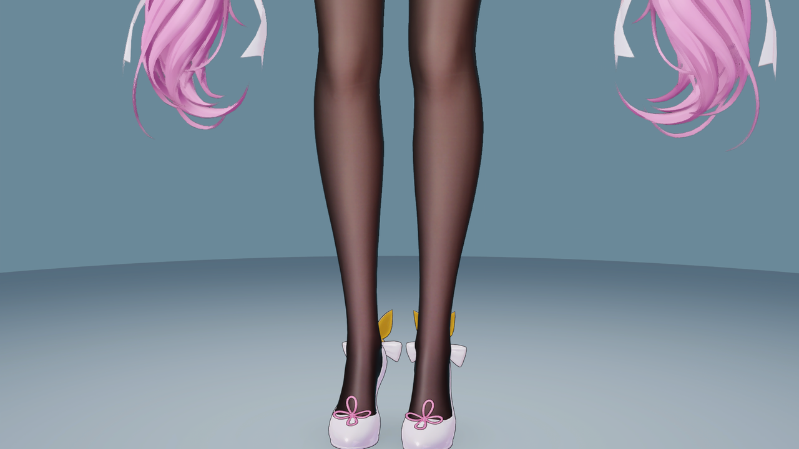

---

## 二、观察真实尼龙织物的特征

先通过实拍和显微影像，观察真实尼龙织物在不同尺度下的几个典型特征。

先看微观纤维层面——这是一张 500 倍扫描电子显微镜（SEM）下真实尼龙丝袜纤维的实拍：

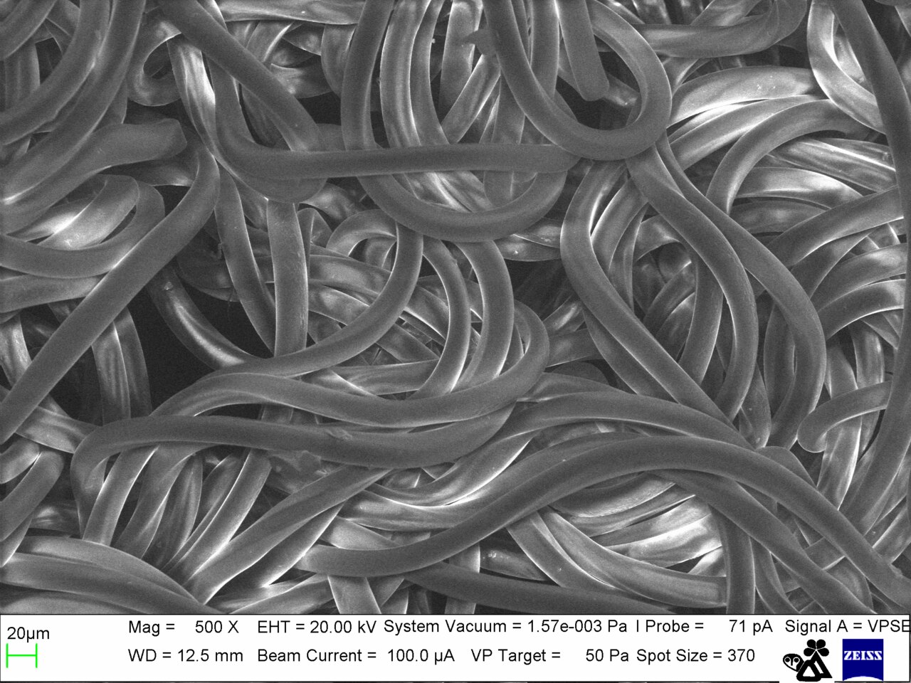

> [ 实拍参考：500× ZEISS 扫描电镜下的尼龙丝袜单丝纤维（来源：MUSE 科学博物馆 / Nicola Angeli，CC BY-SA 3.0）——尼龙是表面光滑的圆柱形合成长丝，不像棉线那样毛糙，因此高光沿纤维方向平滑延展，而不是粗糙发散的漫反射 ]

拉远到光学显微镜尺度，看 40D 黑色尼龙丝袜的真实纬编互锁线圈结构：

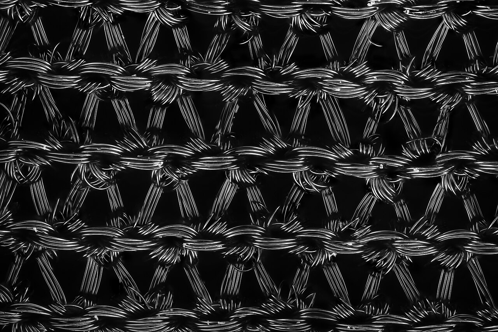

> [ 实拍参考：40D 黑色尼龙丝袜的光学显微实拍（来源：Alexander Klepnev，CC BY 4.0）——正看时视线穿过孔洞看到底下的皮肤，斜看时多层纤维在视线上迅速重叠遮挡，这就是“正面透肉、边缘浓黑”的物理根源 ]

拉远到肉眼平铺尺度，看真实半透明尼龙丝袜的分区编织密度：

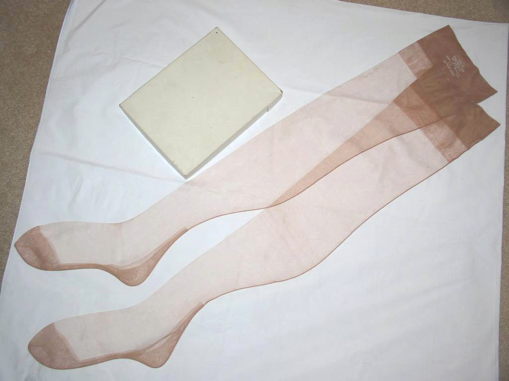

> [ 实拍参考：平铺状态下的真实半透明尼龙丝袜（来源：Tranquil Garden，CC BY-SA 3.0）——腿部主体轻薄半透，袜口、脚跟与足尖则采用了更密的加厚编织带（后文 `StockingDensity.png` 对应这个结构） ]

最后看穿戴状态下的光学透肉渐变与“脱圈抽丝（Ladder / Run）”破损：

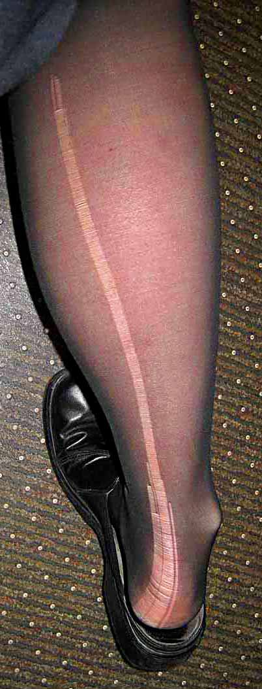

> [ 实拍参考：真实黑丝穿戴与纵向抽丝实拍（来源：Molly / Daniel Case，CC BY-SA 2.0）——小腿正对镜头处透出肤色、左右轮廓边缘压成浓黑；单根线圈断裂后会沿纵行向下脱圈，在脱圈通道里绷出一排横向梯状纬丝 ]

归纳一下，工程中主要围绕下面 3 条特征展开：

1. **角度透肉 + 细腻网眼**：正看透底，斜看浓黑；近景能看到互锁针织网眼和丝脊微弱高光，远景呈哑光丝绒感，袜口与足部自然加厚。
2. **紧绷凹弧 + 干脆回弹**：捏起来像拉紧的弹性膜，外轮廓**向内凹陷**；被掀起的斜侧面因观察角变陡反而更深，松手后迅速贴回腿面，不会来回剧烈晃动。
3. **渐进破损**：不会一扯就破，先出现纵向脱圈抽丝、露出横向梯状纬丝，继续拉才裂开带横丝与回卷毛边的椭圆破洞。

---

## 三、整体制作思路

在 Unity / 团结 HDRP 14 里，单帧更新按以下 5 个步骤串起来：

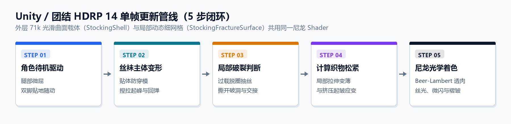

架构上拆成两层：

- **外层 71k 光滑曲面载体（`StockingShell`）**：负责贴体防穿模、骨骼随动、凹弧拉扯和紧绷回弹；
- **局部细网格（`StockingFractureSurface`）+ 状态图集（单腿 `144 × 288`，双腿合并为 `288 × 288`）**：只在真正拉伤的区域生成并接管渲染，负责像素级平滑的抽丝通道和椭圆破口；
- 两层共用**同一份尼龙 Shader**，通过状态图掩码做互补裁剪，避免交界处出现视觉接缝。

---

## 四、尼龙材质：贴图与光学 Shader

先讲材质。整套尼龙渲染写在自定义 HDRP 前向着色器里（双面 `Cull Off`、标准 Alpha 混合 `SrcAlpha OneMinusSrcAlpha`，关闭深度写入 `ZWrite Off`）。

### 4.1 项目里实际用到的贴图

材质核心用到了两张程序化生成的静态特征贴图（加上第六节会导出的运行时破裂状态图和光学底板）：

**1. 编织法线与纱线高度图 `NylonThread.png`（`512 × 512`）**

用单张 RGBA 贴图打包纱线高度与切线空间法线，减少采样次数：

- **`R` 通道**：单根纱线的高度起伏（用来做微弱的编织明暗对比）；
- **`G / A` 通道**：切线空间的编织法线 `normalXY`（在 Shader 里通过 `sqrt(1 - dot(xy, xy))` 重建 Z）。

原始导出的 `NylonThread.png`：

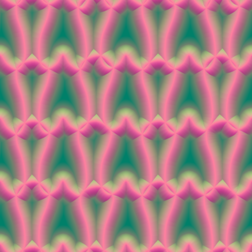

> [ 工程实图：`NylonThread.png`（512×512 原始贴图） ]

将左上角局部放大并拆出 **`R` 通道高度图** 和 **`GA` 通道重建的切线空间法线图**：

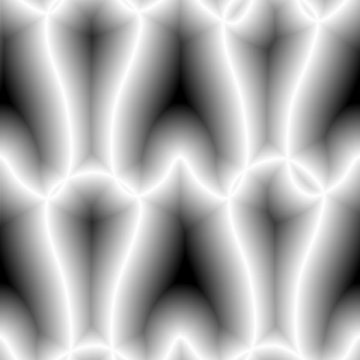

> [ `NylonThread.png` 的 `R` 通道局部放大：白色脊线即交错的针织线圈纱线 ]

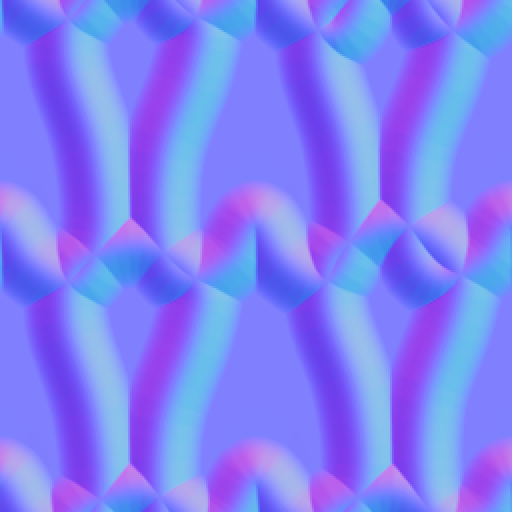

> [ `NylonThread.png` 的 `GA` 通道重建出的切线空间法线：呈现立体圆柱纱线起伏 ]

**2. 袜身密度与加固带贴图 `StockingDensity.png`（`_BaseColorMap` 的 Alpha 通道）**

丝袜的袜口、脚跟与足尖通常织得更密实。工程中用 `StockingDensity.png` 的 Alpha 通道（记作 `band`）记录这层密度分布，叠加到基础覆盖率里：


> [ 工程实图：`StockingDensity.png` 的 Alpha 通道（顶部袜口和底部足尖加厚带） ]

此外在脚踝以下区域，Shader 里加了一层平滑的足部雾面渐变 `footMask = 1.0 - smoothstep(0.05, 0.22, input.uv0.y)`，将基础覆盖率平滑拉高到 `_FrostFootCoverage`，表现脚踝和足部偏厚偏雾的观感。

---

### 4.2 正面透肉、边缘厚黑：Beer-Lambert 光学厚度

尼龙薄膜的透肉渐变按**比尔-朗伯定律（Beer-Lambert Law）**建模。光线斜穿薄膜时，路径长度由视线与法线夹角余弦 $\mu = |\mathbf{N} \cdot \mathbf{V}|$ 决定：

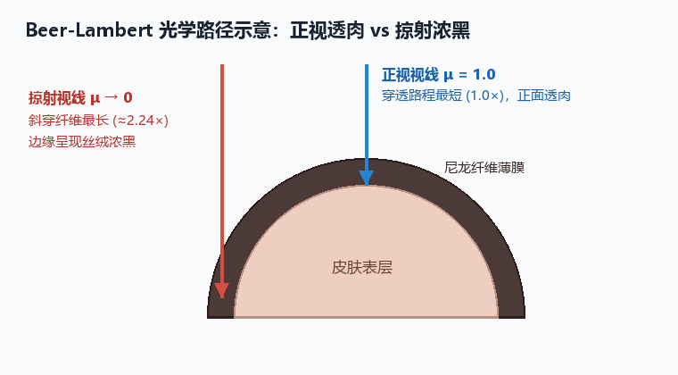

> [ Beer-Lambert 截面射线：正视路径最短（1.0×），掠射边缘斜穿纤维最长（≈2.24×） ]

直接写 `1 / mu` 会在掠射边缘发散，且真实织物掠射到一定角度就会饱和，因此加一个正则化封顶项：

$$\text{path}(\mu) = \frac{1}{\sqrt{0.20 + 0.80\,\mu^2}}$$

再把基础覆盖率 `baseCov` 换算成垂直光学深度 $\tau_0 = -\ln(1 - \text{baseCov})$，乘上路径长度 `path` 与当前纤维密度缩放 `densityScale`，经指数映射转回最终覆盖率 $\alpha = 1 - \exp(-\tau \cdot \text{densityScale})$：

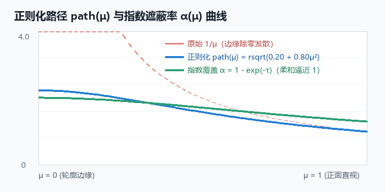

> [ 原始 `1/μ`、正则化 `path(μ)` 与指数覆盖率 `α(μ)` 曲线对比 ]


### 4.3 如何自然的做到拉扯状态下，织物颜色深浅的变化？

物理层每帧会把局部网格的**经纬伸长率 `spacing.xy`** 和**面积变化比（雅可比 `J`）**放进 `TEXCOORD2` 传进来。实现中补了三个细节：

1. **次线性纤维密度缩放 `pow(J, 0.45)`**：真实针织线圈受拉时会先转向拉直，不会按 $1 / J$ 线性变稀；用 `pow(J, 0.45)` 后，中等拉扯下仍能保持一定遮蔽，不会一拉就瞬间透明；

   > 这里，如果不缩放的话，很容易把拉扯时候的材质做成塑料质感。

2. **纱线伸长补偿 `lineLength`**：顺着经纬两个斜交方向估算纱线拉长后的占空变化 `1.0 + 0.28 * (lineLength - 1.0)`；

3. **双面渲染背面防叠黑 `backFaceScale`**：丝袜被捏成圆锥时，视线会同时穿过正面和背面两层布（`Cull Off`）。背面若按 `1.0` 全额叠加，拉起锥体会显得过黑；将背面不透明度系数压到 `0.52`（`isFrontFace ? 1.0 : 0.52`），能保留更自然的双层透光。

核心 HLSL 代码如下：

```hlsl
// 1. 正则化 Beer-Lambert 光学路径
float mu = abs(dot(N, V));
float path = rsqrt(0.20 + 0.80 * mu * mu);

// 2. 脚踝/足部雾面加厚 + 正视皮肤透出微调
float footMask = 1.0 - smoothstep(0.05, 0.22, input.uv0.y);
float bodyCoverage = lerp(_Coverage, max(_Coverage, _FrostFootCoverage), footMask);
float skinBleed = _UseStaticDenier > 0.5
    ? (SafePow(mu, _DenierPower) * _FaceOnSkinBleed * (1.0 - denierThickness * 0.20)) : 0.0;
float baseCov = clamp(saturate(bodyCoverage * (1.0 - skinBleed)) + 0.07 * band, 0.015, 0.96);

// 3. 结合实时形变张量 (spacing, J) 的物理纤维堆积密度
float lineLength = 0.68 * length(spacing * float2(0.30, 0.954))
                 + 0.32 * length(spacing * float2(0.94, 0.341));
float densityScale = 1.0;
if (_FittedNylon > 0.5 && transported)
{
    float strandLength = 1.0 + 0.28 * (lineLength - 1.0);
    float effJ = SafePow(max(J, 0.35), 0.45);
    densityScale = clamp(strandLength / effJ, 0.72, 1.85);
}

// 4. 指数吸收 + 背面防双层叠黑（remaining 为破损剩余纤维比例，完好区域为 1.0）
float tau = -log(1.0 - baseCov) * path;
float meanAlpha = 1.0 - exp(-tau * densityScale * remaining);
float backFaceScale = isFrontFace ? 1.0 : 0.52;
```

---

#### 踩坑：直接按拉起高度叠人工加深

做拉扯着色时踩了第一个坑：早期尝试直接按拉起高度叠一层人工加深，效果很差。

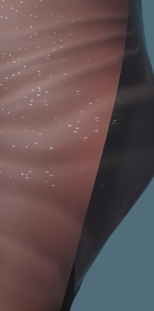

> [ 早期踩坑实拍 ]

把人工加深删掉、只留上面这套纯物理 Beer-Lambert + 变形法线 + PBR 光照后，斜侧面其实自然就变深了：

- 锥面被掀起后法线大幅偏转，$\mu = |\mathbf{N} \cdot \mathbf{V}|$ 减小，`path` 增大；
- 垂直于拉拽方向的侧肩发生泊松收缩，局部 $J < 1$ 让 `densityScale` 增大。

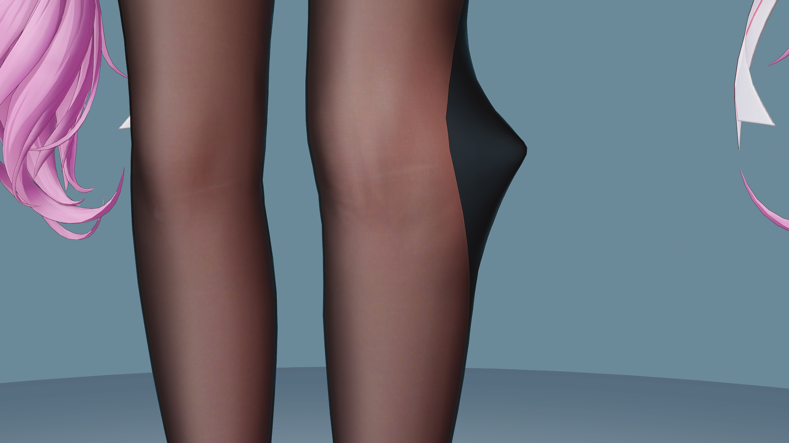

> [ 实机对照：去掉人工加深后，纯物理 Beer-Lambert 光程 + 变形法线 + PBR 光照自然呈现斜侧面加深与双层透光 ]

---

### 4.4 丝绒裹光、各向异性丝光、珠光微闪与影棚边缘光

除透射覆盖率外，光照部分由四层叠加组成：

1. **柔和裹光漫反射（Wrap Diffuse）**：深色丝袜如果走二次元硬阴影色阶（Toon Ramp），腿上会出现生硬的明暗交界线。深色预设改走平滑的 PBR 裹光 `wrapDiff = saturate((ndotl + 0.48) / 1.48)`，配合半球天光补亮，让暗部过渡更柔和；只有白丝预设混入少量二次元冷暖色阶。
2. **各向异性丝光 + 宽绒面高光**：丝袜的经向纱线是细圆柱，高光同时包含 Blinn-Phong `ndoth` 与沿副切线 `B` 展开的各向异性项 `sinTH = sqrt(1 - dot(B, H)^2)`，再叠一层低指数宽范围的丝绒柔光 `velvetRoll = pow(ndoth, 16.0)`。
3. **像素足迹抗锯齿的珠光微闪（Micro-Filament Glints）**：在 UV 上划分高频晶胞 `grainUV`，每个晶胞随机抖动微法线 `microN` 计算 `pow(dot(microN, H), 38.0)`，并用 `grainFootprint = max(length(ddx(grainUV)), length(ddy(grainUV)))` 做抗锯齿门控——拉近看有细腻的针尖微闪，拉远后自动平滑融合，避免远景噪点闪烁。
4. **影棚冷蓝边缘光（Rim）**：沿固定影棚侧后轮廓光方向 `studioRimDir` 叠加一层较弱的冷青蓝掠射高光 `pow(1 - muGeo, 5.6)`，把大腿外侧和拉起轮廓从暗色背景中区分开。

下面这段实机视频按 1 → 4 的顺序逐层叠加，可以直观看到每一层光照的贡献：

<video controls autoplay loop muted playsinline preload="metadata" style="width:100%;border-radius:6px;" src="/media/nylon-pull-and-tear/05_lighting_layers.mp4"></video>

> [ 1080p 60fps 四层光照逐层叠加演示：柔和丝绒裹光 → + 各向异性丝光与宽绒面高光 → + 针尖级珠光微闪 → + 影棚冷蓝边缘光 ]

```hlsl
// 1. 柔和丝绒裹光 + 半球补光
float wrapDiff = saturate((ndotl + 0.48) / 1.48);
float3 velvetLight = lerp(float3(0.48, 0.47, 0.52), float3(1.02, 0.98, 0.96), wrapDiff);
velvetLight += float3(0.11, 0.11, 0.13) * (0.5 + 0.5 * N.y);

// 2. Blinn-Phong + 各向异性丝光 + 宽绒面柔光
float bdotH = dot(B, H);
float sinTH = sqrt(max(0.0, 1.0 - bdotH * bdotH));
float specExp = lerp(22.0, 56.0, smoothVal);
float silkSpec = (SafePow(ndoth, specExp) * 0.76 + SafePow(sinTH, specExp * 0.82) * 0.24)
               * smoothstep(0.18, 0.76, wrapDiff);
float velvetRoll = SafePow(ndoth, 16.0) * smoothstep(0.24, 0.78, wrapDiff)
                 * _PearlStrength * _PearlSpecularStrength * 0.20;

// 3. 带 ddx/ddy 足迹抗锯齿的针尖级珠光微闪
float2 grainUV = input.uv0 * float2(_PearlGrainScale * 0.92, _PearlGrainScale * 2.05);
float2 gCell = floor(grainUV);
float2 gFrac = frac(grainUV) - 0.5;
float2 rnd = frac(sin(float2(dot(gCell, float2(127.1, 311.7)),
                             dot(gCell, float2(269.5, 183.3)))) * 43758.5453);
float grainDot = smoothstep(0.17, 0.02, length(gFrac - (rnd - 0.5) * _PearlRandomness));
float3 microN = normalize(N + (T * (rnd.x - 0.5) + B * (rnd.y - 0.5)) * (0.55 * _PearlRandomness));
float microSpec = SafePow(saturate(dot(microN, H)), 38.0);
float grainAA = 1.0 - smoothstep(0.35, 1.15, max(length(ddx(grainUV)), length(ddy(grainUV))));
float glint = grainDot * microSpec * glintGate * grainAA * _PearlGlintStrength * specBandGate;
```

超微距下的实机渲染（编织微法线起伏、哑光丝绒过渡与高光带内的细微珠光）：

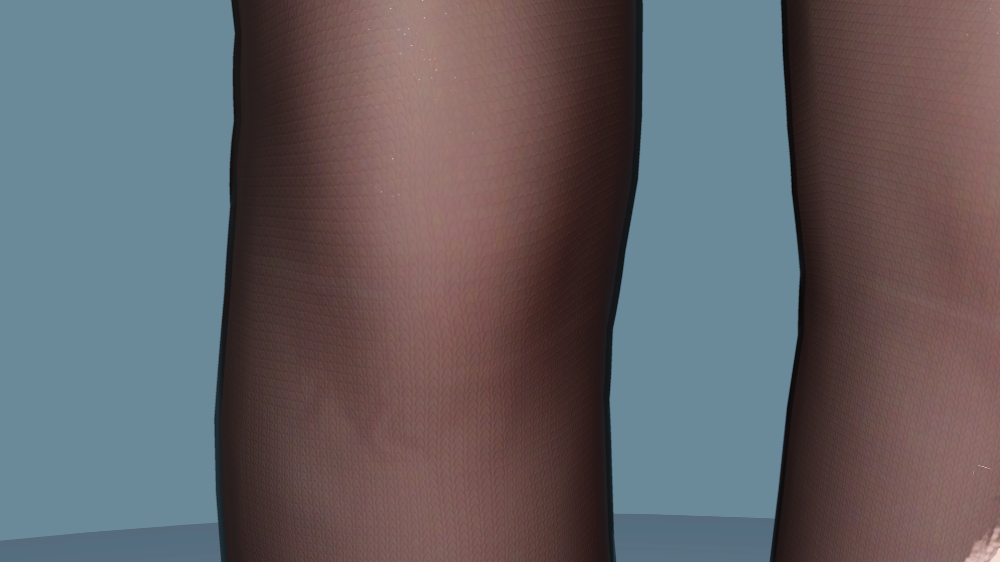

> [ 实机超微距：编织微法线起伏、哑光丝绒渐变与高光带内的针尖珠光微闪 ]

同一套 Shader 通过调整材质参数，可以切出三种不同丹尼尔与配色的预设：

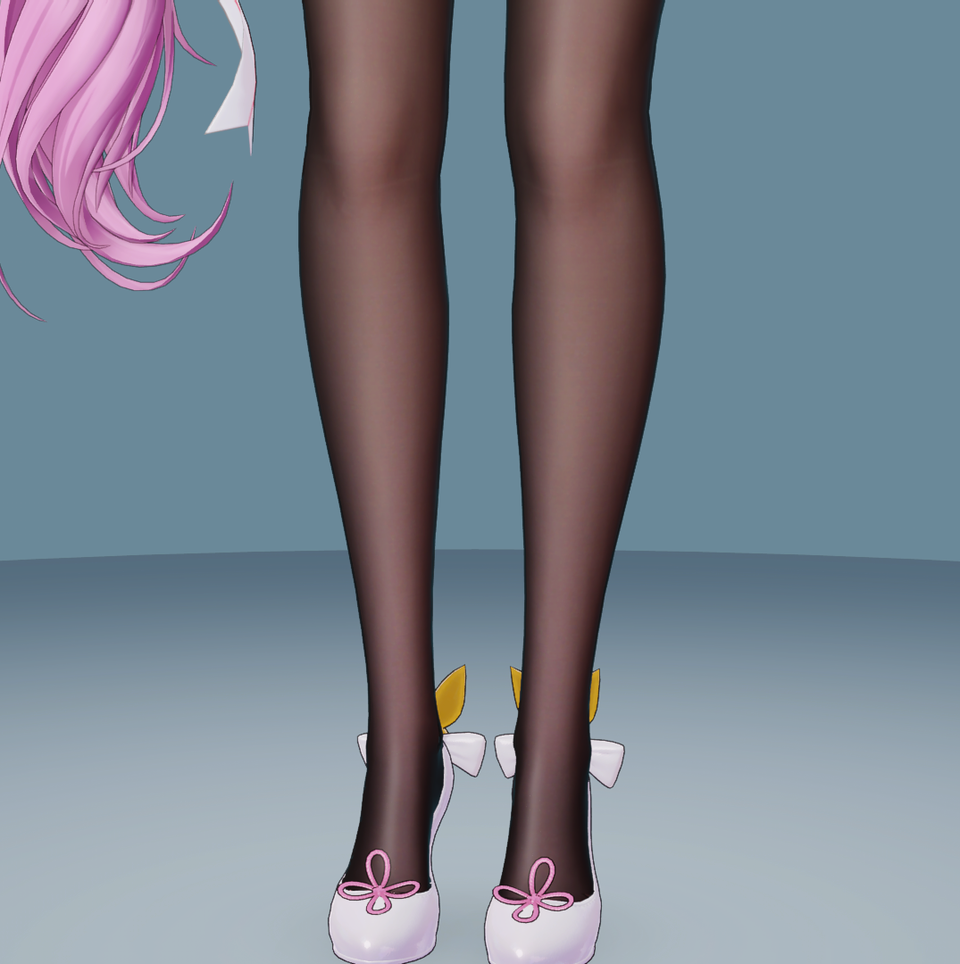

> [ 预设 1：咖丝珠光雾面（高透肉过渡） ]

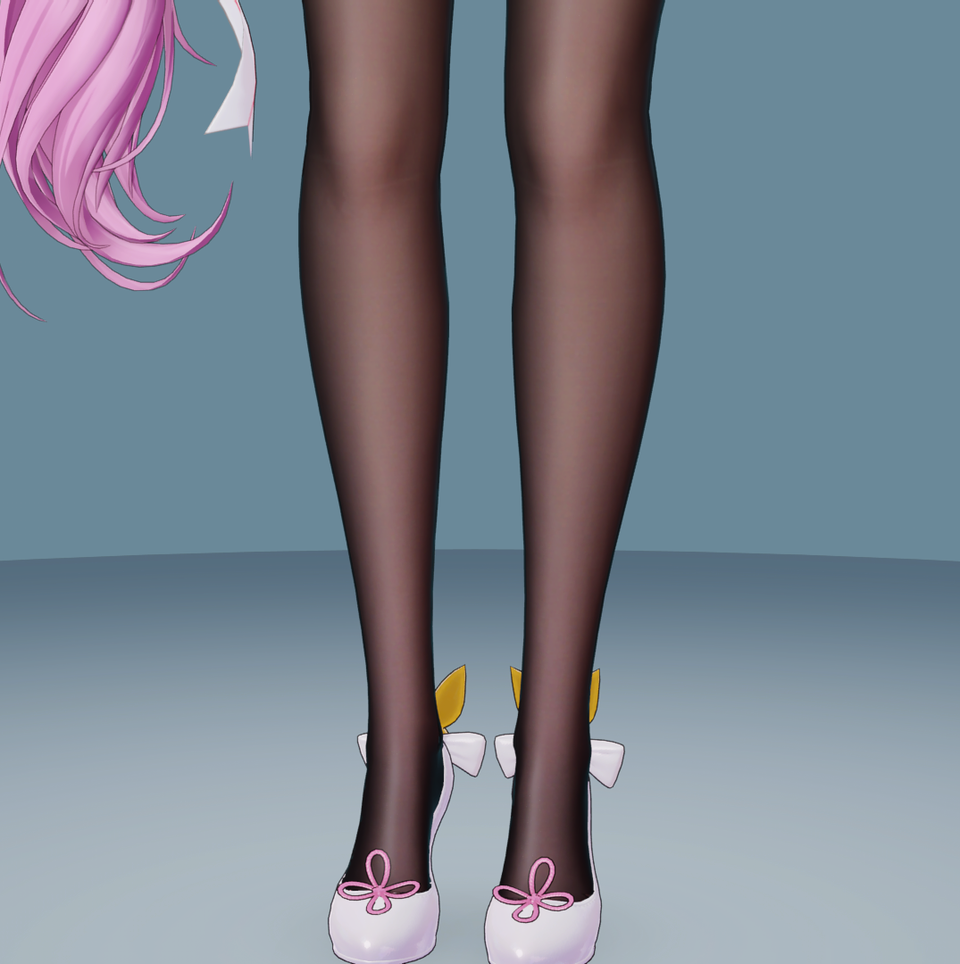

> [ 预设 2：40D 透肉黑丝（深冷石墨绒感） ]

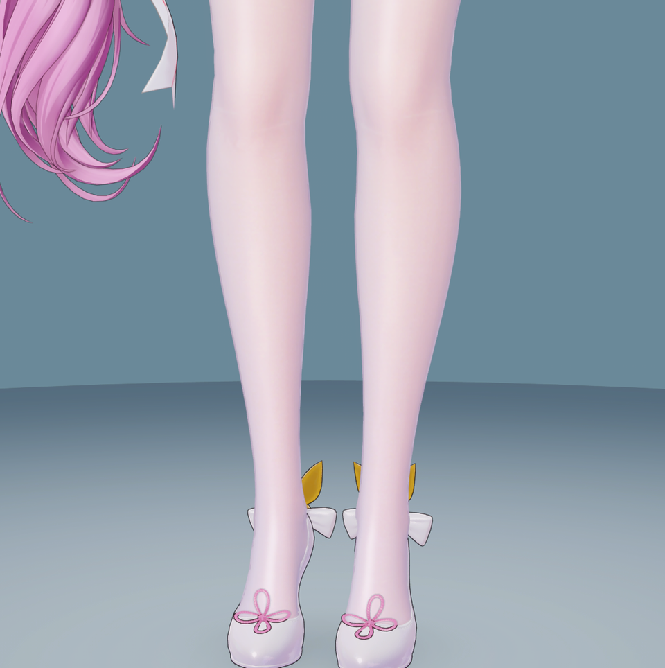

> [ 预设 3：柔雾白丝（丹尼尔冷暖过渡与边缘绒光） ]

---

## 五、拉扯形变、紧绷回弹与曲面细分

### 5.1 表面距离怎么算：3D 圆柱弧测地距离

鼠标点下抓取时，要算出周围每个顶点到捏点的表面距离 `rad`。因为腿的横截面近似圆形，我们在捏点同高度的一圈腿面顶点里算出局部圆心和半径 $R$，把任意顶点的水平弦长 $c = \sqrt{\Delta x^2 + \Delta z^2}$ 用初等几何直接换算成绕腿弧长 $s = 2R\arcsin\bigl(\frac{c}{2R}\bigr)$，再与高度差勾股合成 $\text{rad} = \sqrt{s^2 + \Delta y^2}$：

```csharp
float chordXZ = Mathf.Sqrt(chordSq);
float effR = Mathf.Max(radius, chordXZ * .502f);
float arc = 2f * effR * Mathf.Asin(Mathf.Clamp(chordXZ / (2f * effR), 0f, 1f));
surfaceDistance[i] = Mathf.Sqrt(arc * arc + dy * dy);
```

相比直接在网格上跑图最短路（Dijkstra），这种方法算出的等距线光滑连续，不会沿三角网格边出现多边形折线。

---

### 5.2 向内凹陷轮廓：解决上肩折角

拉扯轮廓早期踩过一个坑：当时把拖拽向量按每个顶点各自的局部法线拆成“法向抬起 + 切向滑动”两项分别衰减。大腿外侧曲率较大，相邻顶点法线转折较快，拉起后外轮廓上肩鼓出了一道明显的折角：

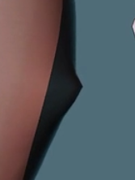

> [ 踩坑实拍：按局部法线拆分抬起/滑移，导致外轮廓上肩出现不自然折痕 ]

修复方式分三点：

1. 所有受影响顶点沿**统一的拖拽位移向量 `displacement`** 移动，不再按局部法线拆开；
2. 衰减函数换成紧支撑 $C^2$ 向内凹陷的幂次核 $(1 - u)^{2.65}$（在影响半径 `rootWidth` 之外值和斜率都严格归零，避免带动过大面积的腿部网格）；
3. 侧肩横向收束用平滑的 `tanh` 替代硬截断 `Clamp`，消除边界一阶导数突变。

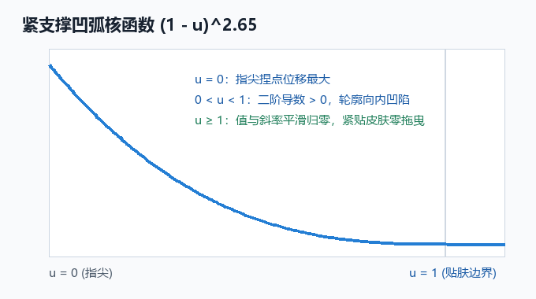

> [ 紧支撑凹弧核 `(1 - u)^2.65`：二阶导数恒大于 0（轮廓向内凹），`u = 1` 处平滑贴回皮肤 ]

```csharp
float rSoft = Mathf.Sqrt(rad * rad + .0055f * .0055f) - .0055f;
float un = Mathf.Clamp01(rSoft / rootWidth);
float free = Mathf.Pow(1f - un, 2.65f);

float shoulder = Vector3.Dot(basePoint - grabOrigin, cross);
float smoothShoulder = .035f * (float)Math.Tanh(shoulder / .035f);

goal += elasticity * (displacement * free
      - cross * (smoothShoulder * free * Mathf.Clamp01(travel / .055f) * .18f));
```

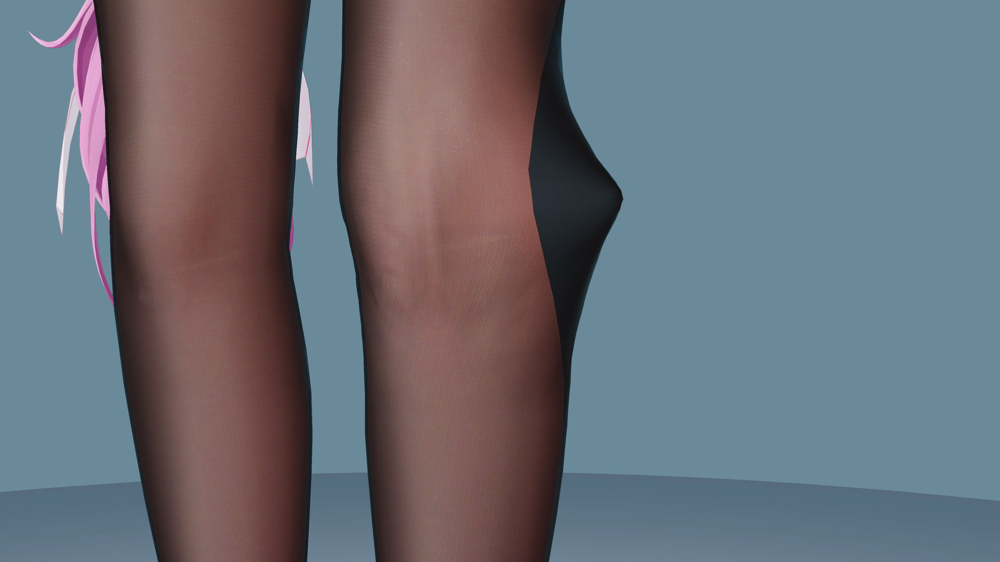

> [ 拉起峰值超近特写 ]

---

### 5.3 松手后的紧绷回弹：解析阻尼谐振子

松手回弹的紧绷感靠一维**阻尼谐振子**的精确解析解实现：

$$\ddot{h} + 2\zeta\omega_n \dot{h} + \omega_n^2 h = 0 \qquad (\omega_n = 46,\ \zeta = 0.76)$$

用闭式 $2 \times 2$ 状态转移系数一步推进，无条件稳定，不受帧率波动或高刚度发散影响，触肤瞬间截断法向速度防穿模：

```csharp
float tension = 46f, damping = 0.76f;
float a = tension * damping;
float b = tension * Mathf.Sqrt(1f - damping * damping);
float env = Mathf.Exp(-a * dt);
float sin = env * Mathf.Sin(b * dt) / b, cos = env * Mathf.Cos(b * dt);
float normalXX = cos + a * sin, normalVX = -tension * tension * sin, normalVV = cos - a * sin;

// 一步精确推进离肤高度与法向速度，触肤即停
float height = normalXX * h + sin * vn;
float speed  = normalVX * h + normalVV * vn;
if (h >= 0 && height <= 0 && speed < 0) height = speed = 0;
```

外侧拉起与松手回弹的 60fps 实机录屏：

<video controls autoplay loop muted playsinline preload="metadata" style="width:100%;border-radius:6px;" src="/media/nylon-pull-and-tear/02_pull_recoil.mp4"></video>

> [ 60fps 纯净录屏：外侧捏拉向内凹陷起峰与松手紧绷回弹 ]

---

### 5.4 细分

原模型双腿只有 `4,440` 个三角形（大腿围一圈约 16 条边），拉起来折线感较重，因此导入时做了 2 级 1 分 4 曲面细分（`4.4k → 17.7k → 71,040` 面，边长降到 `~3.5 mm`）。

工程里导出的 1 级细分 `LegSkin`（17.7k）与 2 级细分 `StockingShell`（71k）膝盖至大腿中段线框：

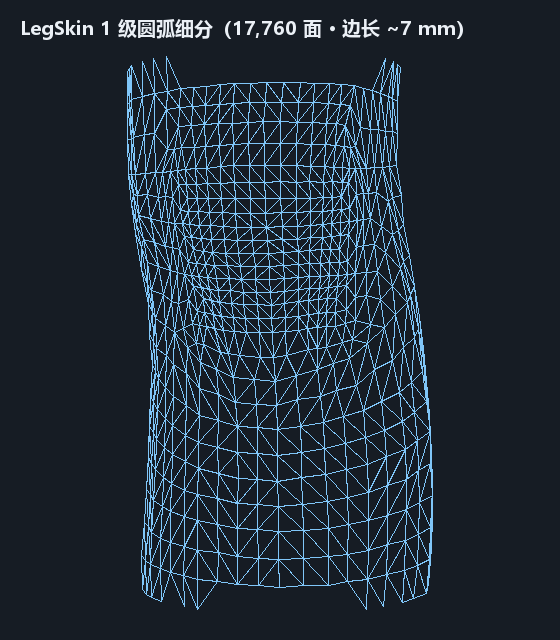

> [ 工程实测线框：`LegSkin` 1 级圆弧细分（17,760 面，边长约 7 mm） ]

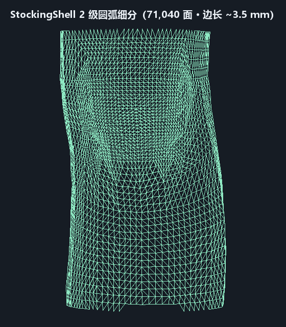

> [ 工程实测线框：`StockingShell` 2 级圆弧细分（71,040 面，边长约 3.5 mm） ]

---

## 六、渐进式针织破裂：从脱圈抽丝到破洞横丝（核心）

### 6.1 运行时状态纹理与光学底板（实图导出）

破损系统没有在 71k 主体网格上硬删三角形，而是用 **一张运行时实时写入的状态图集 `_DamageState`（单腿 `144 × 288`，双腿合并为 `288 × 288`）** + **两张针织Mask `_SlipPlate` / `_RupturePlate`** + **局部细网格** 协作完成。

两张针织Mask：

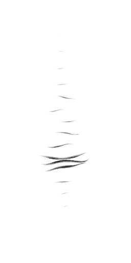

> [ 工程实图：`_SlipPlate`（脱圈滑移时的横向丝缕透光底板） ]

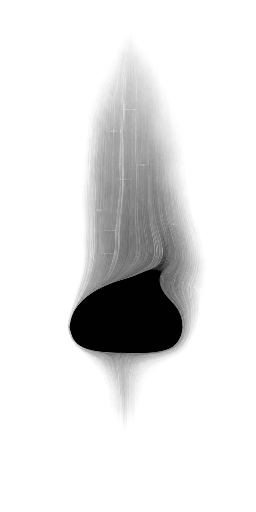

> [ 工程实图：`_RupturePlate`（椭圆破口与上下纵向抽丝通道的纤维质量底板） ]

拉出破洞后，直接从运行时 `MaterialPropertyBlock` 导出的**实时 `_DamageState` 状态图集（`288 × 288`）**——左半边映射左腿，右半边映射右腿；亮蓝色竖条是右腿上已被拉破、移交给局部细网格接管的 `B` 通道 `owned` 掩码：

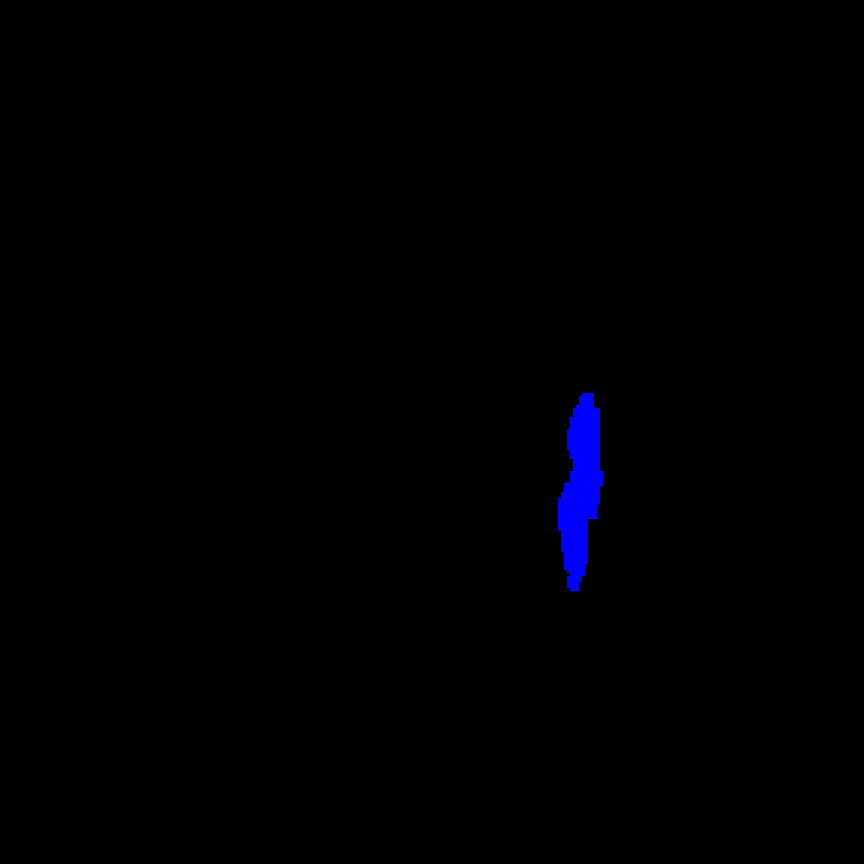

> [ 运行时导出：`_DamageState`（288×288，左右腿分半图集，B 通道亮蓝区域即局部细网格接管范围） ]

### 6.2 载体与局部细网格的零接缝交接

当某块区域被拉破时，程序只在受损局部生成高密度动态细网格（`StockingFractureSurface`）负责破口边缘的物理拉扯和微卷。外层 71k 载体和内层细网格共用**同一份丝袜 Shader**，靠 `_PatchSurface`（载体为 `0`，细网格为 `1`）和状态图 `B` 通道做互补裁剪，避免边界接缝：

```hlsl
float2 atlasUV = float2(
    clamp(frac(input.damageUV.x * 2.0) * 0.5, 0.5 / _DamageAtlas.z, 0.5 - 0.5 / _DamageAtlas.z)
        + (input.damageUV.w > 0.0 ? 0.5 : 0.0), // 根据腿部左右标志选图集左/右半区
    saturate((input.damageUV.y - _DamageAtlas.x) * _DamageAtlas.y));
float4 state = SAMPLE_TEXTURE2D(_DamageState, sampler_DamageState, atlasUV);

float owned = step(0.5, state.b);
float show = lerp(1.0 - owned, owned, fine); // 载体让位，细网格无缝接管
```

### 6.3 梯状横向纬丝与屏幕自适应卷边

破口边缘的两个片元细节：

1. **梯状横向纬丝（Ladder Rungs）**：在脱圈通道 `runShoulder` 里沿经向叠加经 `fwidth` 抗锯齿门控的高频余弦波 `weftRung`，同时调制剩余覆盖率和法线坡度 `slope.y`，形成一排清晰横丝；
2. **屏幕自适应卷边唇缘（Curled Frost Boundary）**：用 `fwidth(opened)` 围绕破口算出恒定约 `5.9 px` 宽的回卷发雾带，略微提高局部堆积覆盖和丝光高光，在远近景下保持一致的边缘宽度。

```hlsl
// 1. 脱圈通道里的横向梯状纬丝
float weftCoord = input.uv0.y * 540.0 + sin(input.uv0.x * 26.0) * 1.1;
float weftAA = 1.0 - smoothstep(0.55, 1.85, fwidth(weftCoord));
float weftRung = (0.5 + 0.5 * cos(weftCoord * 6.2831853)) * weftAA;
slope.y += sin(weftCoord * 6.2831853) * (saturate(runShoulder * 1.15) * 0.18 * weftAA);

// 2. 屏幕自适应卷边发雾唇缘（约 5.9 px）
float openFW = max(fwidth(opened), 0.008);
float boundaryW = openFW * max(_FrostBoundaryWidthPx, 1.0);
float holeRing = smoothstep(0.5 - boundaryW, 0.5 - openFW * 0.40, opened)
               * (1.0 - smoothstep(0.5 - openFW * 0.25, 0.5 + openFW * 0.60, opened));
float frostBoundary = saturate(max(holeRing, max(tearLip * 0.95, runBorder * 0.55))) * _FrostBoundaryStrength;
```

按“完好 → 脱圈抽丝 → 破洞横丝超微距”逐张看实机效果：

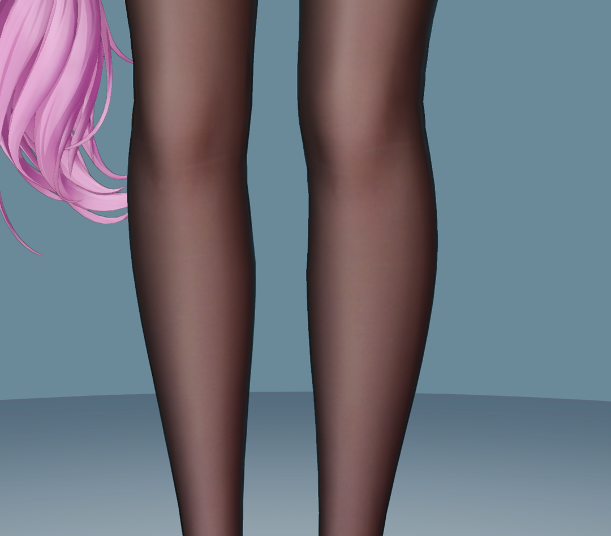

> [ 阶段一：拉扯前的完好哑光丝绒 ]

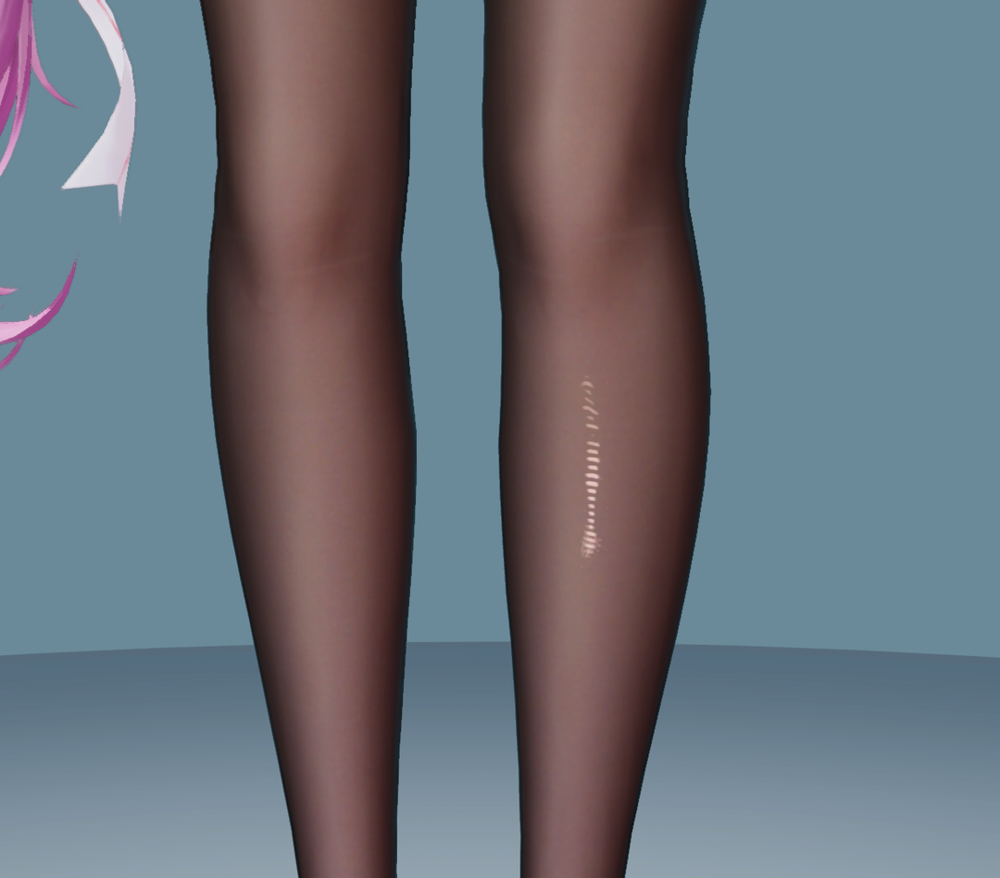

> [ 阶段二：第一轮过载拉扯触发纵向脱圈抽丝（Slip Run） ]

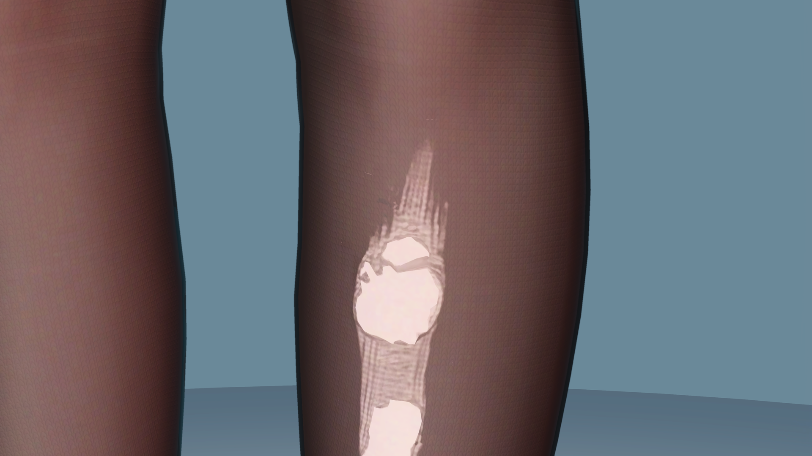

> [ 阶段三超微距：椭圆破口、绷紧的梯状横向纬丝、`5.9 px` 卷边雾缘与破口旁动态松弛褶皱 ]

渐进撕裂过程的 1080p 60fps 实机录屏（脱圈抽丝、双洞连破与横丝微距）：

<video controls autoplay loop muted playsinline preload="metadata" style="width:100%;border-radius:6px;" src="/media/nylon-pull-and-tear/03_progressive_tear.mp4"></video>

> [ 1080p 60fps 实机录屏：脱圈抽丝 → 双洞连破 → 横向梯状纬丝微距 ]

#### 踩坑：使用受力分析来做出破损

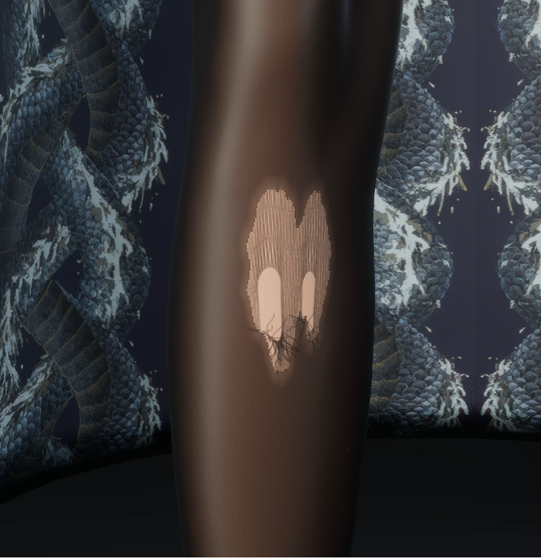

> 早期做的一个方向，效果并不好，性能也差。还是用上面的 Mask 方案做比较好。

---

## 七、1080p 性能实测与 Burst 优化

最后附上 `RTX 4060 + i7-13700`、**1920×1080 HDRP 14** 下的实测帧率基准。

初版一开 441 骨骼待机，帧率从静态的 `174 FPS` 掉到 `9.8 FPS`——拆项后 `88.3 ms` 卡在主线程单核托管 C# 蒙皮上，另有 `6.3 ms` 卡在 `UploadNative` 的托管数组解包与 7 次散装 Mesh 上传。

在不改动画质与 71k 面数的前提下，做了四项优化：

1. **全角色蒙皮迁入 Burst 多核并行 + 跳过锁地静止部件**（`88.3 ms → 3.8 ms`，23×）：去重权重组合 + `BlendBoneWeightsJob` / `SkinMeshJob` 一次并发派发，预扩包围盒配 `FastMeshFlags` 零拷贝直传；
2. **织物计算到提交全 Burst 串联**（`6.33 ms → 1.19–1.58 ms`，5.3×）：`SkinKnitFrame` 直接串联 `PackNativeRenderJob` 零拷贝上传；
3. **增量更新 `skinGap` + 紧凑模式跳过未用 BVH**；
4. **71k 射线拾取垂直距离粗筛**：先用 `perp.sqrMagnitude > 0.025^2` 剔除 ~98.5% 远端三角面。

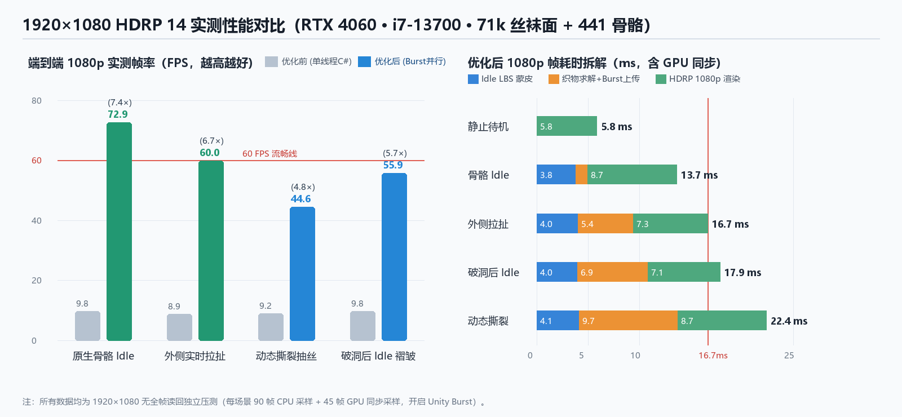

| 工况（1920×1080，71k 丝袜 + 17.7k 腿部 + 441 骨骼） | 优化前                | 优化后                    | 提速     | 优化后分项（Idle / 织物 / 渲染） |
| --------------------------------------------------- | ---------------------:| -------------------------:| --------:| --------------------------------:|
| **静止待机（Idle 关）**                             | 174.0 FPS (`5.75 ms`) | **171.4 FPS (`5.84 ms`)** | —        | `0.00 / 0.00 / 2.43 ms`          |
| **原生骨骼 Idle 站姿**                              | 9.8 FPS (`102.56 ms`) | **72.9 FPS (`13.71 ms`)** | **7.4×** | `3.84 / 1.20 / 4.12 ms`          |
| **实时外侧拉扯**                                    | 8.9 FPS (`112.90 ms`) | **60.0 FPS (`16.68 ms`)** | **6.7×** | `4.02 / 5.39 / 4.05 ms`          |
| **破洞后 Idle 褶皱**                                | 9.8 FPS (`101.86 ms`) | **55.9 FPS (`17.89 ms`)** | **5.7×** | `3.97 / 6.87 / 4.14 ms`          |
| **动态撕裂抽丝**                                    | 9.2 FPS (`108.97 ms`) | **44.6 FPS (`22.45 ms`)** | **4.8×** | `4.13 / 9.65 / 4.29 ms`          |

---

## 参考资料与素材说明

### 1. 视觉与交互参考

- **B 站参考演示**：`-樱花兔-`《Unity 6 HDRP 丝袜物理拉扯与破损效果演示》，[BV159W96uEMo](https://www.bilibili.com/video/BV159W96uEMo)

  > 最近很火的一个Demo，作者从这里得到了非常多的启发。樱花兔大佬做的效果非常好，可惜没有公开技术方案。

### 2. 文中图片与贴图出处说明

- **第二节真实尼龙织物显微与实拍参考图**（`images/real/`，均取自 Wikimedia Commons 开放授权真实摄影/显微影像）：
  - `real_01_sem_500x_muse.jpg`：[*File:Women nylon stockings 500x - SEM MUSE.tif*](https://commons.wikimedia.org/wiki/File:Women_nylon_stockings_500x_-_SEM_MUSE.tif) — 作者：Nicola Angeli / MUSE - Science Museum of Trento（意大利特伦托科学博物馆），许可：[CC BY-SA 3.0](https://creativecommons.org/licenses/by-sa/3.0)。
  - `real_02_knit_40d_microscope.jpg`：[*File:Черные чулки.jpg*](https://commons.wikimedia.org/wiki/File:%D0%A7%D0%B5%D1%80%D0%BD%D1%8B%D0%B5_%D1%87%D1%83%D0%BB%D0%BA%D0%B8.jpg)（40D 黑色尼龙丝袜光学显微照片）— 作者：Alexander Klepnev，许可：[CC BY 4.0](https://creativecommons.org/licenses/by/4.0)。
  - `real_03_sheer_density_flatlay.jpg`：[*File:Sheer stockings.jpg*](https://commons.wikimedia.org/wiki/File:Sheer_stockings.jpg)（半透明尼龙丝袜平铺实拍）— 作者：Tranquil Garden，许可：[CC BY-SA 3.0](https://creativecommons.org/licenses/by-sa/3.0/)。
  - `real_04_stocking_run_ladder.jpg`：[*File:Stocking run.jpg*](https://commons.wikimedia.org/wiki/File:Stocking_run.jpg)（真实黑丝穿戴透肉渐变与纵向脱圈横丝实拍）— 作者：Molly（Daniel Case 裁切调色），许可：[CC BY-SA 2.0](https://creativecommons.org/licenses/by-sa/2.0)。
- **工程静态与运行时程序化贴图**（`images/textures/`）：`NylonThread.png`、`StockingDensity.png`、`_SlipPlate`、`_RupturePlate` 均为工程内程序化生成的纹理资产；`_DamageState` 为团结 Play Mode 运行时直接从 `MaterialPropertyBlock` 导出的实时状态图。
- **原理曲线图与真实网格线框**（`images/diagrams/`）：均由 Python 脚本直接依据文中公式、实测基准 JSON 与工程 `LegSkin` / `StockingShell` 真实网格顶点绘制。
- **实机渲染图与录屏视频**（`images/renders/`、`videos/`）：均在团结 2022.3 HDRP 14 实机录制；
- **演示所用角色模型**：《蓝色星原：旅谣》同人配布模型「涂山小玉 · 桃兔绮乐皮肤 v1.3」（版权归属蛮啾网络，改模制作：晓光忆时），仅作本地非商用技术研究展示。

### 3. 核心图形学与物理参考文献

1. **光学吸收与透射**：Beer–Lambert Law（比尔-朗伯定律）— 薄膜斜穿光程与指数透过率 $\alpha = 1 - e^{-\tau}$ 基础模型。
2. **纤维各向异性高光**：J. T. Kajiya & T. L. Kay, *"Rendering Fur with Three Dimensional Textures"*, SIGGRAPH 1989（文中副切线各向异性丝光项 `sinTH = sqrt(1 - dot(B, H)^2)` 的来源）。
3. **屏幕空间纹理抗混叠**：Nyquist–Shannon Sampling Theorem 及 GPU 屏幕偏导数 `fwidth` / `ddx` / `ddy` 过滤实践（用于高频 `12 × 8` 编织法线抗摩尔纹与珠光微闪足迹衰减）。
4. **曲面平滑细分**：A. Vlachos et al., *"Curved PN Triangles"*, ACM I3D 2001（利用端点顶点法线构造三次 Hermite 曲面拱高的几何思想）。
5. **约束布料与弹性动力学**：M. Macklin, M. Müller & N. Chentanez, *"XPBD: Position-Based Simulation of Compliant Constrained Dynamics"*, MIG 2016（局部细网格破裂边界约束参考）。
6. **Unity 多核并行与零拷贝网格接口**：Unity Documentation — *C# Job System*, *Burst Compiler*, 及 `Mesh.SetVertices(NativeArray<T>, MeshUpdateFlags)`。

以上是整套尼龙织物拉扯与破损的实现拆解，欢迎交流指正。
